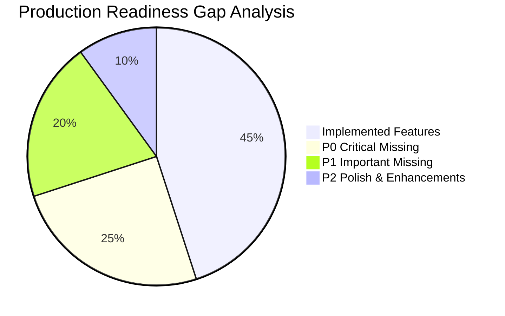
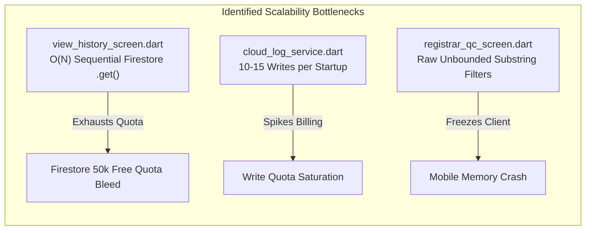

# 01_PROJECT_AUDIT.md
## TraceFoodChain / TraceALot Comprehensive Repository Audit

**Target Platform:** [https://tracealot.com](https://tracealot.com)  
**System Designation:** Enterprise Agricultural Supply Chain Traceability & EUDR Compliance SaaS  
**Audit Date:** October 2026  
**Auditor:** Principal Enterprise Flutter & Cloud Architect / Lead DevOps & Security Auditor  
**Repository Version:** `1.7.4+36 (2026-10-05)`  
**Target Architecture:** Multi-tenant Cloud SaaS (Cloudflare Edge + Google Firebase + openRAL Decentralized Event Engine)

---

## 1. Executive Summary

TraceFoodChain (evolving to **TraceALot**) is an agricultural supply chain tracking and compliance system, with existing implementations centered on the coffee sector in Honduras. The architecture combines an offline-first mobile and web client built in Flutter with the **openRAL** (open Resource Abstraction Layer) framework, backed by Google Cloud Functions (region `europe-west3`) and Cloud Firestore, with cryptographic verification using Ed25519 digital signatures.

### High-Level Status Assessment
| Architecture Pillar | Current Maturity | Target Production Maturity | Critical Blocker |
| :--- | :--- | :--- | :--- |
| **Data Integrity & openRAL** | High (Event sourcing + Ed25519) | Enterprise Event Engine | Dynamic schema validation & lot math missing |
| **Offline-First & Local Storage** | High (Hive + Outboxes + Retries) | Enterprise Resilient Sync | Web storage isolation & background sync gaps |
| **Security & Authorization** | **CRITICAL FAILURE** | Zero-Trust RBAC | **Zero Firestore & Storage Security Rules in repo** |
| **Web & Desktop Readiness** | **POOR** | Enterprise Cloudflare Pages PWA | **No deep linking, broken web sync, desktop UI stubs** |
| **Multi-Tenancy** | **ABSENT** | Organization Partitioning | No organization/company tenant boundaries |
| **EUDR Engine** | Partial (WHISP GeoJSON + DDS PDF) | Certified EUDR Gateway | Polygon validation incomplete, single commodity |
| **DevOps & Infrastructure** | Minimal (Local scripts only) | GitOps CI/CD + Cloudflare Edge | No automated test/build/deploy pipelines |

---

## 2. System Architecture Diagram

```mermaid
graph TB
    subgraph ClientLayer ["Client & Edge Layer (tracealot.com)"]
        CF_DNS["Cloudflare DNS (tracealot.com)"]
        CF_PAGES["Cloudflare Pages (app.tracealot.com)<br/>Flutter Web PWA / CanvasKit"]
        CF_CDN["Cloudflare R2 + CDN (cdn.tracealot.com)<br/>GeoJSON, Media, DDS Documents"]
        CF_WORKER["Cloudflare Worker API Gateway (api.tracealot.com)<br/>Auth, Rate Limiting, GeoID Proxy"]
        PUB_QR["Public Consumer Portal (tracealot.com/p/:lotId)<br/>Edge SSR HTML Traceability"]
        MOB_APP["Native Mobile Clients<br/>(Android APK / iOS IPA)"]
    end

    subgraph IdentitySec ["Identity & Cryptographic Security"]
        FAUTH["Firebase Authentication<br/>(JWT, OAuth2, SMS OTP)"]
        APPCHECK["Firebase App Check<br/>(reCAPTCHA Enterprise / Play Integrity)"]
        KEY_MGR["Client KeyManager<br/>(Ed25519 User Private Key in Secure Storage)"]
    end

    subgraph BackendGCP ["Cloud Backend (GCP / Firebase europe-west3)"]
        GCF_SYNC["Cloud Functions: syncMethodToCloud<br/>(Signature Verification & Conflict Resolution)"]
        GCF_PULL["Cloud Functions: syncFromCloudBeta<br/>(Delta Hashes & Paginated Sync)"]
        GCF_WHISP["Cloud Functions: checkWhispProxy<br/>(Deforestation Risk Analysis)"]
        GCF_USER["Cloud Functions: persistPublicKey / findUserByEmail"]
        
        FS_OBJ["Firestore: TFC_objects<br/>(Materialized openRAL Entities)"]
        FS_METH["Firestore: TFC_methods<br/>(Immutable Event Sourcing Log)"]
        FS_LOG["Firestore: TFC_cloudlog<br/>(Client Diagnostic Sessions)"]
        GCS_MEDIA["Firebase Storage<br/>(Field Photos & Boundary Attachments)"]
    end

    subgraph ExternalServices ["External Institutional Services"]
        WHISP_API["OpenForis WHISP API<br/>(Satellite Deforestation Risk)"]
        AGSTACK_AR["Linux Foundation AgStack<br/>(Asset Registry / S2 GeoID)"]
        IHCAFE_DB["IHCAFE Directory<br/>(Honduran Coffee Institute Registry)"]
        EU_TRACES["EU TRACES NT Gateway<br/>(EUDR Due Diligence Repository)"]
    end

    MOB_APP -->|Ed25519 Signed Methods| GCF_SYNC
    MOB_APP -->|Delta Pull Requests| GCF_PULL
    CF_PAGES -->|Firestore Web SDK Direct| FS_OBJ
    CF_PAGES -->|Cloud Function Calls| GCF_SYNC
    CF_WORKER --> GCF_SYNC
    CF_WORKER --> GCF_PULL
    PUB_QR --> CF_WORKER
    
    MOB_APP -.-> KEY_MGR
    CF_PAGES -.-> KEY_MGR
    MOB_APP --> FAUTH
    CF_PAGES --> FAUTH
    MOB_APP --> APPCHECK
    CF_PAGES --> APPCHECK

    GCF_SYNC --> FS_METH
    GCF_SYNC --> FS_OBJ
    GCF_PULL --> FS_METH
    GCF_PULL --> FS_OBJ
    GCF_WHISP --> WHISP_API
    GCF_SYNC --> AGSTACK_AR
    MOB_APP --> GCS_MEDIA
    CF_PAGES --> GCS_MEDIA
    GCF_SYNC --> EU_TRACES
```

---

## 3. Feature Inventory (Current Implementation)

| Domain | Feature | File / Component | State | Description |
| :--- | :--- | :--- | :--- | :--- |
| **Identity & Security** | Ed25519 Signing | `lib/helpers/digital_signature.dart` | Production Ready | Generates per-user cryptographic signatures on every method. |
| **Identity & Security** | Key Storage | `lib/helpers/key_management.dart` | Production Ready | Stores seeds in `FlutterSecureStorage` per user UID. |
| **Identity & Security** | Authentication | `lib/screens/sign_up_screen.dart` | Functional / Flawed | Email/password sign-in with auto-signup fallback (anti-pattern). |
| **Identity & Security** | Role Hierarchy | `lib/services/role_management_service.dart` | Functional | Role levels: SUPERADMIN (1000), tfcAdmin (500), registrarCoordinator (300), others (100). |
| **Offline Storage** | Hive Store | `lib/main.dart`, `database_helper.dart` | Production Ready | Per-user boxes `localStorage_<uid>`, templates `openRALTemplates`. |
| **Offline Storage** | Push Retry Outbox | `lib/services/sync_outbox_service.dart` | Production Ready | Exponential backoff (30s to 15m) + jitter; staging box for pulls. |
| **Offline Storage** | Media Outbox | `lib/services/media_outbox_service.dart` | Production Ready | State machine: `capturedLocal` -> `uploading` -> `confirmedRemote`. |
| **GIS & Polygons** | Boundary Recorder | `lib/widgets/polygon_recorder_widget.dart` | Advanced | GPS tracking, manual corner addition, Shoelace area calculation. |
| **GIS & Polygons** | Field Boundary Link | `lib/widgets/field_boundary_recorder.dart` | Production Ready | Enforces Farm-Field link with container UID and triple redundancy. |
| **GIS & Polygons** | Boundary Editor | `lib/widgets/field_polygon_editor.dart` | Advanced | Move, add, delete corners with centroid recalculation. |
| **GIS & Polygons** | Geometry Service | `lib/services/field_geometry_service.dart` | Production Ready | Recalculates Shoelace ha, updates farm total area, saves via `changeObjectData`. |
| **QC Workflow** | QC Dashboard | `lib/screens/registrar_qc_screen.dart` | Advanced (144KB) | Approval/rejection of pending farms, fields, and farmer human objects. |
| **QC Workflow** | Map Overview | `lib/widgets/qc_overview_map.dart` | Functional | Satellite view of field polygons and GPS points. |
| **Bulk Ingestion** | Fast CSV Upload | `lib/screens/fast_upload_screen.dart` | Functional | Bulk CSV plot boundaries -> GeoJSON -> AgStack Asset Registry. |
| **Bulk Ingestion** | Excel Farmer Import | `lib/services/excel_farmer_import_service.dart` | Functional | Excel import for producers without existing Asset Registry plots. |
| **External APIs** | WHISP Deforestation | `lib/services/whisp_api_service.dart` | Functional | Calls WHISP proxy for GeoJSON/WKT risk assessment. |
| **External APIs** | AgStack AR | `lib/services/asset_registry_api_service.dart` | Functional | HMAC-SHA256 authenticated API client for S2 plot indexing. |
| **External APIs** | IHCAFE Directory | `lib/services/ihcafe_producer_service.dart` | Functional | Fuzzy matching for Honduran national coffee producers. |
| **Trade & Coffee** | Buy Coffee Stepper | `lib/widgets/stepper_buy_coffee.dart` | Functional | Multi-step transaction creating `changeContainer` & `changeOwner`. |
| **Trade & Coffee** | First Sale Stepper | `lib/widgets/stepper_first_sale.dart` | Functional | Producer-to-trader initial sale with harvest and field links. |
| **Trade & Coffee** | Sell Coffee Stepper | `lib/widgets/stepper_sell_coffee.dart` | Functional | Offline container trade between users. |
| **Compliance** | Due Diligence PDF | `lib/services/pdf_generator_service.dart` | Functional | Generates PDF statement with EORI, plots, and Green Bean conversion. |
| **P2P Data Sharing** | QR Code Movie | `lib/widgets/qr_code_sender.dart` | Advanced | Animated chunked GZip base64 QR stream for air-gapped peer transfer. |
| **Localization** | 4-Language ARB | `lib/l10n/` | Functional | German, English, Spanish, French via `flutter_localizations`. |

---

## 4. Missing Feature Inventory (Enterprise Production Gaps)

### Critical Missing Production Features
1. **Multi-Tenant SaaS Boundary:** No `organizationId` or `tenantId` in openRAL data structures. All users currently operate in a shared global space.
2. **Missing User Roles:** Lack of dedicated roles for `Organization Admin`, `Quality Controller`, `Exporter`, `Auditor`, `Public Consumer`.
3. **Public Consumer Traceability Portal:** Zero web interface for consumer QR scanning. Scanning a bag QR code currently leads nowhere for non-authenticated web visitors.
4. **Lot Splitting & Mass Balance:** Aggregation (`aggregateItems.dart`) only packs items into a container. It cannot split a 10,000 kg batch into smaller lots, blend lots with weighted property preservation, or deduct roasting/milling yield losses.
5. **Shipment & Chain-of-Custody Manifests:** No digital Bill of Lading (BoL), container seal tracking, phytosanitary certificate binding, or customs declaration tracking.
6. **EUDR XML / TRACES-NT Direct Submission:** The PDF generation cannot be submitted directly to EU TRACES NT; it requires structured GeoJSON/XML according to EU Regulation 2023/1115 schemas.
7. **Web Deep Linking & Navigation:** Router only defines `/`, `/registrar`, and `/auth`. No URL-based state or web navigation.
8. **Automated Cloud Backups & Point-in-Time Recovery:** No Cloud Storage export cron or disaster recovery runbook.
9. **Analytics & Performance Monitoring:** Firebase Performance, Crashlytics, and BigQuery streaming are not configured.

---

## 5. Technical Debt Inventory

### High-Risk Architectural Debt
1. **Proliferation of Global State (`main.dart`):**
   - `Box<Map<dynamic, dynamic>>? localStorage;`
   - `late Box<Map<dynamic, dynamic>> openRALTemplates;`
   - `late Map<String, Map<String, dynamic>> cloudConnectors;`
   - `Map<String, dynamic>? appUserDoc;`
   - Global `TrackedValueNotifier`s: `repaintContainerList`, `rebuildSpeedDial`, `inboxCount`, `isSyncing`, `uploadProgress`.
   - *Impact:* Race conditions during user switching, untestable tight coupling, and memory leaks.
2. **Hardcoded Country-Specific Logic ("Honduras"):**
   - Hardcoded in `main.dart:39`, `stepper_first_sale.dart:33`, `field_boundary_recorder.dart:811`, `service_functions.dart:144`.
   - Uses Honduran administrative divisions (Aldea, Municipio, Departamento) and weight units (Quintales, Manzanas) globally.
   - *Impact:* Cannot deploy to Colombia, Brazil, Vietnam, Kenya, or Ethiopia without code modifications.
3. **Desktop Web Sync Suppression Anti-Pattern:**
   - In `main.dart`, `splash_screen.dart`, and `home_screen.dart`: `syncFromCloud: !isWebLandscape`.
   - When opened in desktop web landscape mode, background sync is completely disabled.
   - *Impact:* Desktop web clients fail to pull updates unless manually prompted or bypassed via raw Firestore queries.
4. **Massive Monolithic Widgets:**
   - `registrar_qc_screen.dart` is **3,925 lines (144 KB)**.
   - `stepper_registrar_registration.dart` is **2,200 lines (88 KB)**.
   - `fast_upload_screen.dart` is **2,081 lines (83 KB)**.
   - `field_registry_screen.dart` is **1,985 lines (77 KB)**.
   - *Impact:* Fragile UI rendering, build method mutations, difficult regression testing.
5. **Empty Stub Methods in `database_helper.dart`:**
   - `getProductsWithPrices()`, `getOrdersForBuyer()`, `getInventory()`, `updateInventoryItem()`, `syncHarvests()`, `updateDeliveryStatus()`, `getDeliveryHistory()`, `getActiveDeliveries()` are empty stubs returning `[]` or `""`.

---

## 6. Security Audit Findings

| ID | Severity | Vulnerability Description | Location | Remediation Required |
| :--- | :--- | :--- | :--- | :--- |
| **SEC-01** | **CRITICAL** | **No Firestore Security Rules in Repository.** | Root / Firebase Console | Implement strict declarative rules enforcing RBAC and schema validation. |
| **SEC-02** | **CRITICAL** | **No Cloud Storage Security Rules in Repository.** | Firebase Storage | Enforce owner/tenant authentication and MIME type validation. |
| **SEC-03** | **HIGH** | **Client-side API Key Exposure in `.env`.** | `.env`, `initial_data.dart` | Proxy WHISP and AgStack calls via Cloudflare Workers / Cloud Functions. |
| **SEC-04** | **HIGH** | **Sign-in / Sign-up Ambiguity.** | `sign_up_screen.dart:47` | Separate Login from Registration to avoid account enumeration and credential confusion. |
| **SEC-05** | **MEDIUM** | **Emergency Role Assignment Script.** | `emergency_role_assignment.dart` | Remove emergency script; establish audited Cloud IAM role assignment. |
| **SEC-06** | **MEDIUM** | **Unrestricted Client Logging to Firestore.** | `cloud_log_service.dart` | Enforce log rate-limiting or route logs to Google Cloud Logging via Worker. |

---

## 7. Scalability & Performance Audit

1. **O(N) Sequential Cloud Lookups in `view_history_screen.dart`:**
   - Lines 57-73 execute `FirebaseFirestore.instance.collection('TFC_objects').doc(uid).get()` in a sequential `for` loop for every registered item.
   - 500 registrations trigger 500 round-trip HTTP requests, blocking the main thread and exhausting Firestore read quotas.
2. **Excessive Diagnostic Write Operations:**
   - `CloudLogService` logs 8 to 15 entries on every app launch to `TFC_cloudlog/{userId}/sessions/{sessionId}/logs/{autoId}`.
   - 1,000 active users generate ~50,000 writes/day solely for diagnostics.
3. **In-Memory Client-Side Filtering:**
   - In `registrar_qc_screen.dart`, because Firestore does not support case-insensitive full-text or composite openRAL queries without dedicated indexes, hundreds of documents are fetched and filtered in memory.

---

## 8. Firebase Architecture Audit

### Current vs. Recommended Firebase Configuration
| Service | Current Status | Production Standard | Action Required |
| :--- | :--- | :--- | :--- |
| **Firebase Auth** | Email/Password only | Email + Magic Link + Google OAuth + Phone OTP | Implement Multi-Provider Auth + Custom Claims |
| **Firestore** | Direct client SDK access | Security Rules + Composite Indexes + Aggregations | Deploy `firestore.rules` and `firestore.indexes.json` |
| **Cloud Storage** | Direct client upload | Direct R2/GCS with Pre-signed URLs | Migrate bulk public media to Cloudflare R2 |
| **App Check** | Not implemented | reCAPTCHA v3 (Web) + Play Integrity (Android) | Register App Check in `main.dart` |
| **Cloud Messaging** | Configured in `pubspec` | Functional targeted FCM push notifications | Implement server-side notification trigger pipeline |
| **Remote Config** | Absent | Dynamic feature toggles & regional thresholds | Integrate `firebase_remote_config` |

---

## 9. Flutter Web Readiness Audit

1. **Routing Architecture:**
   - Currently uses `Navigator.push` with `MaterialPageRoute`.
   - Browser URL bar always displays `https://tracealot.com/#/` regardless of active screen.
   - Browser back button exits the app rather than popping sub-screens.
   - **Fix:** Refactor navigation to `go_router` with declarative, bookmarkable paths (`/farms/:id`, `/qc`, `/fields`).
2. **Renderer Selection (HTML vs CanvasKit vs WebAssembly):**
   - Web GIS mapping (`google_maps_flutter_web`) and complex polygons require CanvasKit or Flutter 3.24+ WebAssembly (`skwasm`).
   - HTML renderer introduces text rasterization artifacts in complex data grids.
3. **SEO & Social Graph:**
   - Current `web/index.html` has generic metadata.
   - Public traceability pages (`/p/:lotId`) cannot be indexed if rendered exclusively via client CanvasKit.
   - **Fix:** Implement Cloudflare Worker Edge SSR for public bot/crawler previews.

---

## 10. Cloudflare Pages Readiness Audit

1. **Single-Page Application (SPA) Fallback:**
   - Cloudflare Pages requires a `_redirects` file (`/* /index.html 200`) or custom Worker to prevent 404s on direct deep link reloads.
2. **Security Headers (`_headers`):**
   - Need strict Content Security Policy (CSP) allowing Google Maps JavaScript API, Firebase Auth, and Cloud Functions endpoints while preventing XSS.
3. **Asset Caching:**
   - `flutter.js`, `main.dart.js`, and CanvasKit wasm files should have immutable cache headers with versioned query strings (improving on `web_cache_invalidation.py`).

---

## 11. Production Launch Checklist

### Pre-Deployment Verification
- [ ] Implement declarative, zero-trust `firestore.rules` and `storage.rules`.
- [ ] Migrate navigation to `go_router` with browser history and deep linking.
- [ ] Establish Organization/Tenant schema isolation.
- [ ] Deploy Cloudflare Worker API Gateway at `api.tracealot.com`.
- [ ] Connect custom domains on Cloudflare Pages (`app.tracealot.com`).
- [ ] Create public consumer traceability screen at `tracealot.com/p/:lotId`.
- [ ] Replace hardcoded "Honduras" references with dynamic regional configuration.
- [ ] Optimize batch Firestore queries to replace O(N) linear loops.
- [ ] Implement Geodesic WGS84 polygon validation and self-intersection checks.
- [ ] Establish automated GitHub Actions CI/CD for test, build, and deploy.
