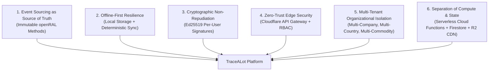
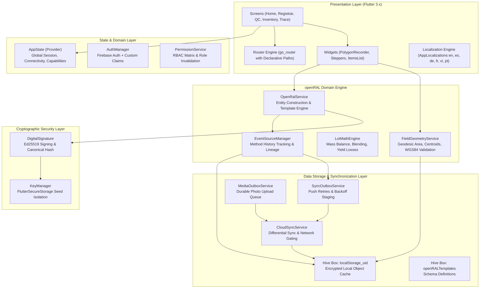
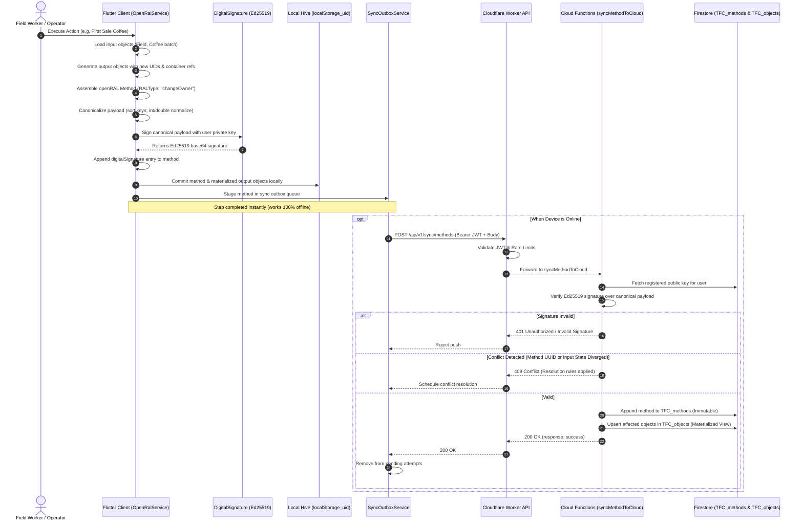
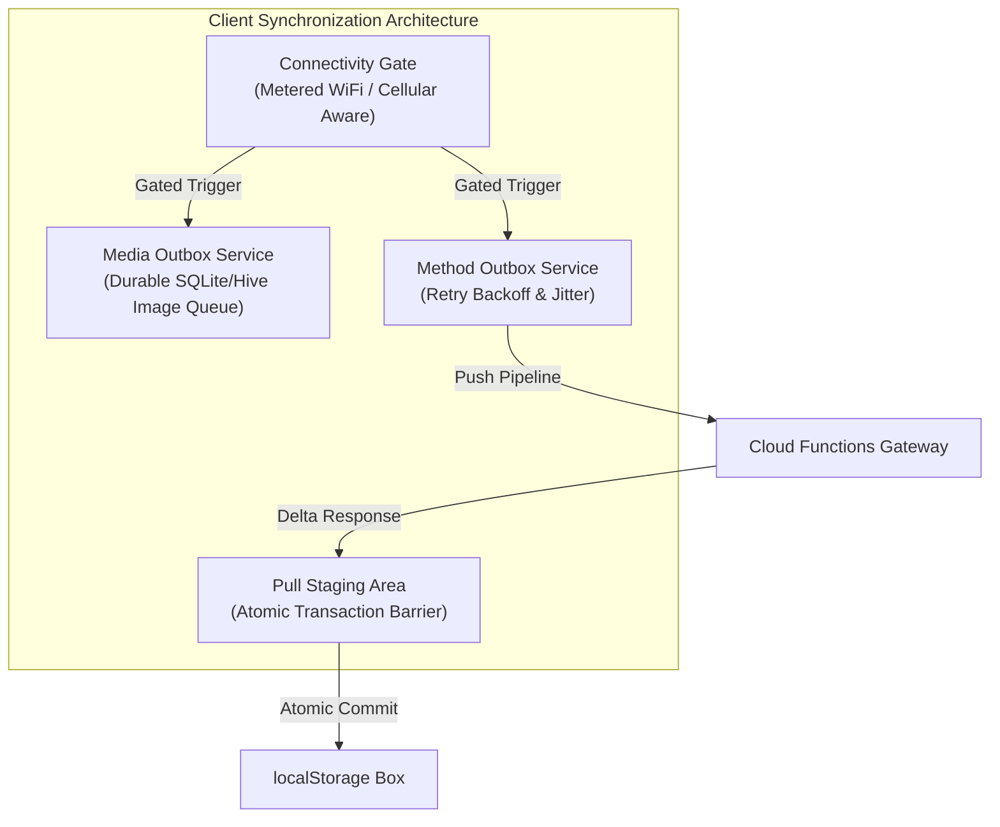
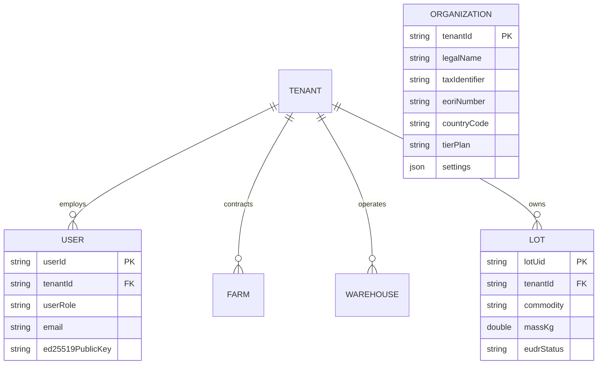

# 02_ARCHITECTURE.md
## TraceALot SaaS Target System Architecture & Technical Specifications

**Target Domain:** [https://tracealot.com](https://tracealot.com)  
**System Designation:** Enterprise Multi-Tenant Supply Chain Traceability & EUDR Compliance Platform  
**Architecture Classification:** Edge-Distributed, Event-Sourced, Offline-First Cryptographic Ledger  
**Standards Compliance:** openRAL 1.0, EU Regulation 2023/1115 (EUDR), ISO/IEC 19987 (EPCIS 2.0), WGS84, RFC 7946 (GeoJSON)

---

## 1. Architectural Principles & Vision

TraceALot is designed to transition from a single-commodity, single-country regional tracking tool into a globally scalable SaaS platform for agricultural traceability and regulatory due diligence. The architecture adheres to six core architectural principles:



---

## 2. C4 Architecture Model

### Level 1: System Context Diagram

```mermaid
C4Context
    title System Context: TraceALot Traceability Platform

    Person(farmer, "Farmer / Producer", "Registers farm plots, harvests coffee, records initial sales.")
    Person(registrar, "Field Registrar", "Surveys farm polygons, records farmer IDs, submits verification bundles.")
    Person(qc, "QC Controller / Agronomist", "Audits field polygons, approves/rejects registrations, checks deforestation.")
    Person(trader, "Trader / Aggregator", "Purchases cherry/parchment, aggregates batches, manages warehouse containers.")
    Person(processor, "Dry Mill Processor", "Processes coffee (hulling, grading, sorting), tracks conversion yields.")
    Person(exporter, "Exporter", "Consolidates shipping lots, issues EUDR Due Diligence Statements, books containers.")
    Person(importer, "EU Importer / Roaster", "Verifies DDS, validates chain of custody, tracks roast batches.")
    Person(consumer, "Public Consumer", "Scans product QR code on retail pack to view verifiable origin journey.")

    System(tracealot, "TraceALot SaaS Platform", "Event-sourced supply chain tracking, polygon validation, and EUDR compliance engine.")

    System_Ext(whisp, "OpenForis WHISP API", "Satellite deforestation analysis (FAO / EU Joint Research Centre).")
    System_Ext(agstack, "AgStack Asset Registry", "Linux Foundation decentralized geo-registry for agricultural plots.")
    System_Ext(traces, "EU TRACES NT", "European Commission trade control and expert system for EUDR declarations.")
    System_Ext(firebase, "Google Firebase / GCP", "Authentication, Firestore NoSQL, Cloud Functions, and push notifications.")
    System_Ext(cloudflare, "Cloudflare Edge", "DNS, DDoS mitigation, Pages hosting, Workers API gateway, and R2 object storage.")

    Rel(farmer, tracealot, "Interacts via Mobile App (Offline/Online)")
    Rel(registrar, tracealot, "Records plots & identities via Mobile App")
    Rel(qc, tracealot, "Reviews geometry & compliance via Web/Desktop")
    Rel(trader, tracealot, "Manages inventory & buy/sell steppers")
    Rel(processor, tracealot, "Records milling & lot transformations")
    Rel(exporter, tracealot, "Generates export declarations & DDS")
    Rel(importer, tracealot, "Audits chain-of-custody & batches")
    Rel(consumer, tracealot, "Scans QR codes via mobile web (No Auth)")

    Rel(tracealot, whisp, "Submits GeoJSON/WKT for deforestation risk scoring")
    Rel(tracealot, agstack, "Registers farm polygons, retrieves global GeoIDs")
    Rel(tracealot, traces, "Submits EUDR Due Diligence Statements (XML/JSON)")
    Rel(tracealot, cloudflare, "Edge routing, caching, and static web distribution")
    Rel(tracealot, firebase, "Identity, event storage, and transactional compute")
```



---

### Level 2: Container Diagram (Detailed Systems View)

```mermaid
graph TB
    subgraph ClientSpace ["Clients & Endpoints"]
        MOB["Mobile App (Flutter Native)<br/>Android / iOS (Offline-First)"]
        WEB["Management Portal (Flutter Web)<br/>app.tracealot.com (CanvasKit / Wasm)"]
        PUB["Consumer Portal (Edge SSR)<br/>tracealot.com/p/:lotId"]
    end

    subgraph EdgeSpace ["Cloudflare Edge Infrastructure"]
        CF_DNS["Cloudflare DNS & SSL/TLS<br/>Full (Strict)"]
        CF_PAGES["Cloudflare Pages<br/>Static Assets & SPA Routing"]
        CF_WORKER["Cloudflare Worker API Gateway<br/>api.tracealot.com"]
        CF_R2["Cloudflare R2 Storage<br/>cdn.tracealot.com (Media & PDFs)"]
    end

    subgraph GCPSpace ["Google Cloud Platform (europe-west3)"]
        FAUTH["Firebase Authentication<br/>JWT / OAuth2 / Custom Claims"]
        
        subgraph CloudFunctions ["Serverless Compute (Node.js / Go)"]
            FN_SYNC["syncMethodToCloud<br/>Signature Verification & Conflict Logic"]
            FN_PULL["syncFromCloudBeta<br/>Hash Differencing & Pagination"]
            FN_WHISP["checkWhispProxy<br/>Satellite Risk Pipeline"]
            FN_EUDR["eudrStatementEngine<br/>XML & Digital Twin Bundle Generator"]
            FN_TRACES["tracesNtConnector<br/>B2G Submission Pipeline"]
        end

        subgraph DataTier ["Persistence Tier"]
            FS_OBJ[("Firestore: TFC_objects<br/>Materialized Entity Views")]
            FS_METH[("Firestore: TFC_methods<br/>Append-Only Event Ledger")]
            FS_ORGS[("Firestore: TFC_organizations<br/>Tenant Metadata & Quotas")]
            FS_KEYS[("Firestore: TFC_keys<br/>Registered Public Key Registry")]
        end
    end

    MOB --> CF_DNS
    WEB --> CF_DNS
    PUB --> CF_DNS

    CF_DNS --> CF_PAGES
    CF_DNS --> CF_WORKER
    CF_DNS --> CF_R2

    CF_WORKER --> FAUTH
    CF_WORKER --> CloudFunctions
    
    MOB -->|Push Signed Methods| CF_WORKER
    MOB -->|Pull Deltas| CF_WORKER
    MOB -->|Upload Media| CF_R2

    WEB -->|Direct Read (Cached)| FS_OBJ
    WEB -->|Submit Mutations| CF_WORKER

    FN_SYNC --> FS_METH
    FN_SYNC --> FS_OBJ
    FN_SYNC --> FS_KEYS
    FN_PULL --> FS_METH
    FN_PULL --> FS_OBJ
    FN_EUDR --> FS_OBJ
    FN_EUDR --> CF_R2
```

---

### Level 3: Component Diagram (Flutter Client Core)



---

## 3. Event Sourcing & openRAL Architectural Paradigm

In TraceALot, state is not mutated in place. All changes in the physical supply chain (planting, harvesting, moving, processing, quality grading, transferring ownership) are modeled as immutable **openRAL Methods**.

### Method Execution Lifecycle



---

## 4. Cryptographic Trust Architecture

Every openRAL action carries non-repudiable cryptographic proof. 

### Key Pair Generation & Management
- **Algorithm:** Ed25519 (Edwards-curve Digital Signature Algorithm, RFC 8032).
- **Key Generation:** Generated client-side using `cryptography` package from cryptographically secure random bytes (`SimpleKeyPair.newKeyPair()`).
- **Private Key Storage:** Private key seed is stored in platform-specific secure hardware:
  - **Android:** Android KeyStore with EncryptedSharedPreferences (AES-256-GCM).
  - **iOS:** iOS Keychain Services with `kSecAttrAccessibleAfterFirstUnlockThisDeviceOnly`.
  - **Web:** Web Cryptography API (`crypto.subtle`) backed by non-exportable IndexedDB key wrapper.
- **Public Key Registration:** On first login or key rollover, the client transmits the base64-encoded public key to `persistPublicKey` via Cloud Function. The public key is stored in `TFC_keys/{userId}` with timestamp, device ID, and cryptographic fingerprint.

### Canonical Serialization Rules
To prevent verification failures across diverse platforms (Dart on mobile, V8 in Cloud Functions/Node.js, Rust on edge workers):
1. **Dictionary Ordering:** All JSON map keys must be recursively sorted in lexicographical ASCII order.
2. **Numeric Representation:** Floating point numbers representing whole numbers (e.g. `25.0`) must be normalized to integers (`25`) via `jsonFullDoubleToInt()`.
3. **Exclusion of Variable Metadata:** Transient flags (`hasMergeConflict`, `needsSync`, `digitalSignatures`) are stripped before hashing.

---

## 5. Online/Offline Synchronization Engine

The synchronization architecture guarantees eventual consistency under hostile field network conditions (remote coffee fincas in Honduras, Colombia, or Vietnam).

### Synchronization Subsystems


### 1. Media Outbox State Chain
Photos of farm boundaries, identity documents, and quality certificates traverse an explicit state machine:
$$\text{capturedLocal} \longrightarrow \text{uploading} \longrightarrow \text{uploadedUnverified} \longrightarrow \text{confirmedRemote} \longrightarrow \text{deletedLocal}$$
- If an upload terminates midway, it resumes using byte-range chunking.
- On Web, raw image bytes (`Uint8List`) are retained in memory/IndexedDB since browser blob URLs are destroyed on tab closure.

### 2. Method Push Retry with Exponential Backoff & Jitter
When a push fails due to network dropout or 5xx server errors, `SyncOutboxService` calculates the next retry:
$$t_{\text{retry}} = \min(t_{\text{base}} \times 2^{\text{attempt}} + \text{jitter}, t_{\text{max}})$$
- $t_{\text{base}} = 30\text{ seconds}$
- $t_{\text{max}} = 15\text{ minutes}$
- $\text{jitter} = \text{random}(0, 15\text{ seconds})$

### 3. Differential Delta Pull (`syncFromCloudBeta`)
To minimize cellular data consumption in rural areas:
1. Client generates cryptographic hashes of its local openRAL object IDs and version timestamps.
2. Cloud Function evaluates the hash vector against the user's materialized Firestore collection.
3. Only changed, deleted, or newly granted documents are returned in a paginated, compressed payload (page size: 50 documents).
4. Downloaded payloads enter a **staging box**. If the connection breaks during a 200-document sync, the staging box is purged. Only when all pages arrive is the batch atomically committed into `localStorage`.

---

## 6. Multi-Tenant SaaS Architecture

The platform architecture partitions data across tenants while enabling seamless inter-tenant supply chain transactions (e.g. Cooperative in Honduras selling to an Importer in Germany).



### Multi-Commodity Support (EUDR Annex I)
The schema supports the 7 commodities regulated under the EU Deforestation Regulation:
1. **Coffee** (*Coffea arabica*, *Coffea canephora*)
2. **Cocoa** (*Theobroma cacao*)
3. **Soy** (*Glycine max*)
4. **Oil Palm** (*Elaeis guineensis*)
5. **Cattle / Beef**
6. **Wood / Timber**
7. **Rubber** (*Hevea brasiliensis*)

Each commodity template defines specific conversion factors (e.g. fresh coffee cherry $\rightarrow$ wet parchment $\rightarrow$ dry parchment $\rightarrow$ green coffee bean $\rightarrow$ roasted coffee bean).

---

## 7. Cloudflare Edge Layer & Gateway Architecture

Cloudflare serves as the global ingress, security shield, and static host for `tracealot.com`.

### Domain Layout & Routing Matrix
| Domain / FQDN | Cloudflare Service | Destination / Backend | Purpose |
| :--- | :--- | :--- | :--- |
| **`tracealot.com`** | Cloudflare Pages / Worker | Edge SSR Static Site + QR Resolver | Marketing landing page & `/p/:lotId` public traceability |
| **`app.tracealot.com`** | Cloudflare Pages | Flutter Web Application Bundle | Authenticated SaaS portal (Admin, QC, Trader, Registrar) |
| **`api.tracealot.com`** | Cloudflare Worker | GCP europe-west3 Cloud Functions | API Gateway: JWT validation, rate limiting, routing |
| **`cdn.tracealot.com`** | Cloudflare R2 + CDN Cache | Cloudflare R2 Storage Bucket | Public asset distribution (field photos, DDS PDFs) |
| **`admin.tracealot.com`** | Cloudflare Access (Zero Trust) | Route to `app.tracealot.com/#/admin` | Protected Super Admin back-office interface |
