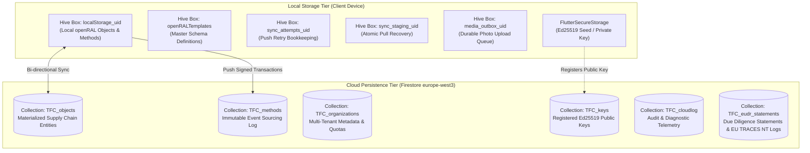
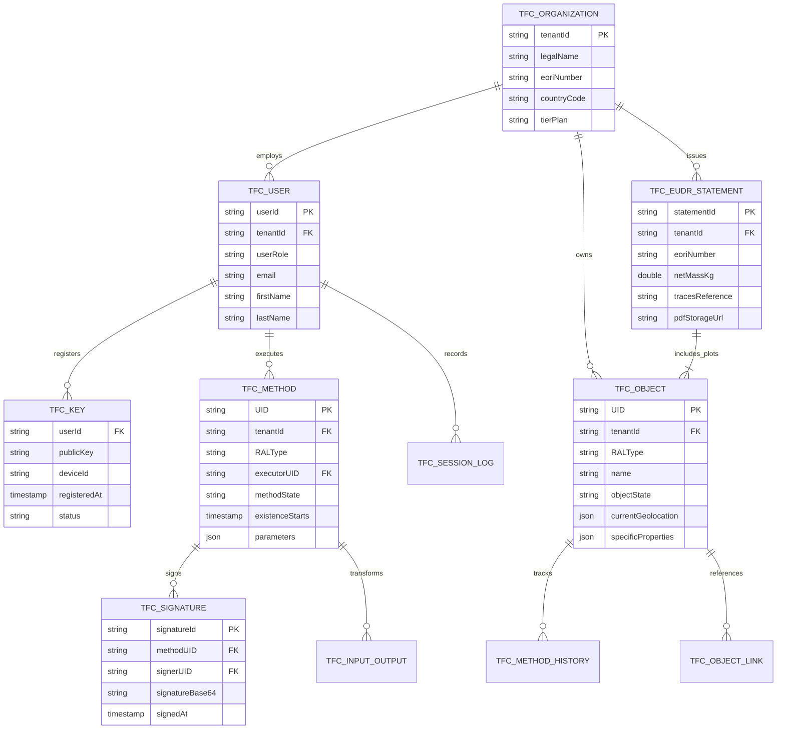
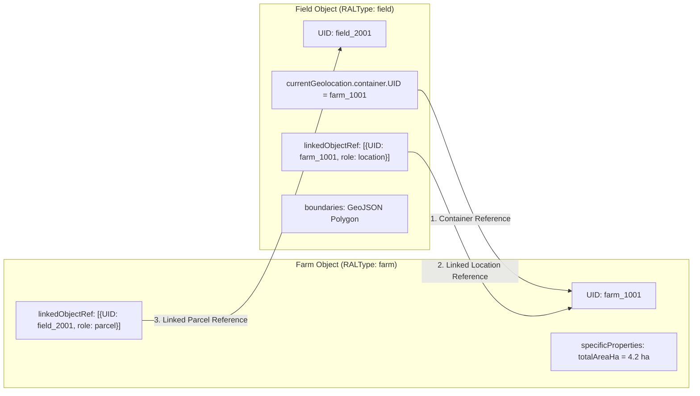

# 03_DATABASE_DESIGN.md
## TraceALot Database Architecture, Schema Specifications & ERD

**Target Platform:** [https://tracealot.com](https://tracealot.com)  
**Persistence Paradigm:** Dual-Tier Polyglot Storage (Cloud Firestore NoSQL + Client Hive / IndexedDB)  
**Data Model Framework:** openRAL (open Resource Abstraction Layer) 1.0 JSON Specification  
**Compliance Standard:** EU Deforestation Regulation (EUDR) Article 9 Geolocation & Chain-of-Custody Schema

---

## 1. Storage Architecture Overview

TraceALot operates on a bifurcated persistence architecture:
1. **Remote Cloud Persistence (Google Cloud Firestore):** Stores canonical materialized object states (`TFC_objects`), the append-only cryptographic event ledger (`TFC_methods`), organization metadata (`TFC_organizations`), public key certificates (`TFC_keys`), and diagnostic logs (`TFC_cloudlog`).
2. **Local Client Persistence (Hive & Secure Storage):** Employs isolated, per-user encrypted key-value boxes (`localStorage_<userId>`) on mobile and desktop, plus specialized sidecars for sync retry state and media queues.



---

## 2. Cloud Firestore Schema Specifications

### 2.1 Collection: `TFC_objects`
Stores the current materialized snapshot of all physical and logical supply chain entities. Document ID equals the entity's openRAL UUID (`doc.identity.UID`).

```json
{
  "$schema": "http://json-schema.org/draft-07/schema#",
  "type": "object",
  "required": ["identity", "template", "objectState", "currentOwners", "currentGeolocation"],
  "properties": {
    "identity": {
      "type": "object",
      "required": ["UID", "name"],
      "properties": {
        "UID": { "type": "string", "format": "uuid" },
        "name": { "type": "string" },
        "siteTag": { "type": "string" },
        "alternateIDs": {
          "type": "array",
          "items": {
            "type": "object",
            "properties": {
              "UID": { "type": "string" },
              "issuedBy": { "type": "string" }
            }
          }
        },
        "alternateNames": { "type": "array", "items": { "type": "string" } }
      }
    },
    "tenantId": { "type": "string", "description": "Multi-tenant organization boundary ID" },
    "template": {
      "type": "object",
      "required": ["RALType", "version"],
      "properties": {
        "RALType": { 
          "type": "string", 
          "enum": ["farm", "field", "human", "coffee", "container", "bag", "building", "transportVehicle", "company", "image"] 
        },
        "version": { "type": "string" },
        "objectStateTemplates": { "type": "string" }
      }
    },
    "objectState": {
      "type": "string",
      "enum": ["active", "qcPending", "qcApproved", "qcRejected", "archived", "destroyed"]
    },
    "currentOwners": {
      "type": "array",
      "items": {
        "type": "object",
        "required": ["UID", "role"],
        "properties": {
          "UID": { "type": "string" },
          "role": { "type": "string", "enum": ["owner", "custodian", "carrier", "processor"] }
        }
      }
    },
    "currentGeolocation": {
      "type": "object",
      "properties": {
        "container": {
          "type": "object",
          "properties": { "UID": { "type": "string" } }
        },
        "geoCoordinates": {
          "type": "object",
          "properties": {
            "latitude": { "type": "number" },
            "longitude": { "type": "number" }
          }
        },
        "postalAddress": {
          "type": "object",
          "properties": {
            "country": { "type": "string" },
            "cityName": { "type": "string" },
            "cityNumber": { "type": "string" },
            "streetName": { "type": "string" },
            "streetNumber": { "type": "string" }
          }
        },
        "plusCode": { "type": "string" },
        "3WordCode": { "type": "string" }
      }
    },
    "specificProperties": {
      "type": "array",
      "items": {
        "type": "object",
        "required": ["name", "value", "unit"],
        "properties": {
          "name": { "type": "string" },
          "value": {},
          "unit": { "type": "string" }
        }
      }
    },
    "locationHistoryRef": { "type": "array", "items": { "type": "string" } },
    "ownerHistoryRef": { "type": "array", "items": { "type": "string" } },
    "methodHistoryRef": { "type": "array", "items": { "type": "string" } },
    "linkedObjectRef": {
      "type": "array",
      "items": {
        "type": "object",
        "properties": {
          "UID": { "type": "string" },
          "RALType": { "type": "string" },
          "role": { "type": "string" }
        }
      }
    }
  }
}
```

---

### 2.2 Collection: `TFC_methods`
Stores the immutable event sourcing stream. Every method represents an atomic event executed by a verified identity. Document ID equals method UUID.

```json
{
  "$schema": "http://json-schema.org/draft-07/schema#",
  "type": "object",
  "required": ["identity", "template", "executor", "inputObjects", "outputObjects", "methodState", "digitalSignatures"],
  "properties": {
    "identity": {
      "type": "object",
      "required": ["UID"],
      "properties": {
        "UID": { "type": "string", "format": "uuid" },
        "name": { "type": "string" }
      }
    },
    "tenantId": { "type": "string" },
    "template": {
      "type": "object",
      "required": ["RALType", "version"],
      "properties": {
        "RALType": {
          "type": "string",
          "enum": [
            "generateDigitalSibling",
            "harvest",
            "changeContainer",
            "changeOwner",
            "changeProcessingState",
            "changeObjectData",
            "changeUserRole",
            "performQualityControl",
            "splitBatch",
            "mergeLots",
            "issueEudrStatement"
          ]
        },
        "version": { "type": "string" }
      }
    },
    "methodState": {
      "type": "string",
      "enum": ["started", "inProgress", "finished", "cancelled"]
    },
    "executor": {
      "type": "object",
      "required": ["identity"],
      "properties": {
        "identity": {
          "type": "object",
          "properties": { "UID": { "type": "string" } }
        }
      }
    },
    "existenceStarts": { "type": "string", "format": "date-time" },
    "existenceEnds": { "type": "string", "format": "date-time" },
    "inputObjects": {
      "type": "array",
      "description": "Snapshots or references of entities consumed or updated by this method"
    },
    "outputObjects": {
      "type": "array",
      "description": "Snapshots of entities created or mutated by this method"
    },
    "parameters": {
      "type": "array",
      "items": {
        "type": "object",
        "properties": {
          "name": { "type": "string" },
          "value": {},
          "unit": { "type": "string" }
        }
      }
    },
    "digitalSignatures": {
      "type": "array",
      "minItems": 1,
      "items": {
        "type": "object",
        "required": ["signature", "signerUID", "timestamp"],
        "properties": {
          "signature": { "type": "string", "description": "Base64 Ed25519 signature" },
          "signerUID": { "type": "string" },
          "timestamp": { "type": "string", "format": "date-time" },
          "publicKey": { "type": "string" }
        }
      }
    }
  }
}
```

---

### 2.3 Collection: `TFC_organizations` (New Multi-Tenant Collection)
Enables organizational scoping, enterprise tier control, and localized settings.

```json
{
  "tenantId": "org_coop_montana_hn",
  "legalName": "Cooperativa Cafetalera Montana Verde Limitada",
  "tradeName": "Montana Verde Coffee",
  "taxIdentifier": "RTN-05019001234567",
  "eoriNumber": "NL820123456",
  "countryCode": "HN",
  "primaryCommodity": "coffee",
  "tierPlan": "enterprise",
  "createdAt": "2026-01-15T08:00:00Z",
  "settings": {
    "defaultWeightUnit": "quintales",
    "defaultAreaUnit": "manzanas",
    "requireQcBeforeSale": true,
    "whispRiskThreshold": "low",
    "allowedRoles": ["Farmer", "Registrar", "Quality Controller", "Trader", "Processor", "Exporter"]
  },
  "contact": {
    "email": "operations@montanaverde.hn",
    "phone": "+504 2234 5678",
    "address": "Marcala, La Paz, Honduras"
  }
}
```

---

### 2.4 Collection: `TFC_keys`
Maintains verified Ed25519 public keys mapped to users for server-side cryptographic audit.

```json
{
  "userId": "firebase_auth_uid_12345",
  "tenantId": "org_coop_montana_hn",
  "publicKey": "dGhpcy1pcy1hbi1lZDI1NTE5LXB1YmxpYy1rZXktYmFzZTY0Cg==",
  "deviceId": "samsung_sm_g991b_android_14",
  "registeredAt": "2026-02-10T14:32:00Z",
  "status": "active",
  "previousKeys": []
}
```

---

### 2.5 Collection: `TFC_eudr_statements`
Persists generated EUDR Due Diligence Statements, verified plots, and B2G submission receipts.

```json
{
  "statementId": "DDS-2026-HN-COOP-0042",
  "tenantId": "org_coop_montana_hn",
  "createdDate": "2026-10-14T10:00:00Z",
  "operator": {
    "name": "Montana Verde Coffee Exporters",
    "eori": "NL820123456",
    "address": "Marcala, La Paz, Honduras"
  },
  "commodity": {
    "hsCode": "0901.11.00",
    "description": "Green Coffee Beans (Coffea Arabica)",
    "netMassKg": 19200.0,
    "greenBeanEquivalentKg": 19200.0
  },
  "plots": [
    {
      "geoId": "agstack_s2_8_13_4a8b7c9d",
      "farmName": "Finca La Esperanza",
      "producerName": "Carlos Mendoza",
      "areaHa": 2.45,
      "centroid": { "latitude": 14.1523, "longitude": -88.0345 },
      "whispDeforestationRisk": "Zero / Negligible",
      "whispScore": 0.00
    }
  ],
  "tracesNtSubmission": {
    "status": "SUBMITTED",
    "referenceNumber": "TRACES-EUDR-2026-0098712",
    "submissionTimestamp": "2026-10-14T11:15:00Z",
    "verificationHash": "e3b0c44298fc1c149afbf4c8996fb92427ae41e4649b934ca495991b7852b855"
  },
  "pdfStorageUrl": "https://cdn.tracealot.com/dds/2026/DDS-2026-HN-COOP-0042.pdf"
}
```

---

## 3. Entity-Relationship Diagram (ERD)



---

## 4. openRAL Entity Relationship & Container Redundancy

To ensure total integrity during offline disconnected synchronization, TraceALot enforces a **Triple-Redundancy Linkage Graph** between spatial containers (Farms, Warehouses, Shipping Containers) and nested entities (Fields, Coffee Batches, Bags):



### Triple Redundancy Verification Rules:
1. **Container Reference:** `field.currentGeolocation.container.UID == farm.identity.UID`.
2. **Child-to-Parent Link:** `field.linkedObjectRef` contains entry with `UID == farm.identity.UID` and `role == 'location'`.
3. **Parent-to-Child Link:** `farm.linkedObjectRef` contains entry with `UID == field.identity.UID` and `role == 'parcel'`.

If any single relationship is severed due to an asynchronous offline synchronization conflict, the client or Cloud Function reconciler repairs the remaining two links automatically.

---

## 5. Firestore Composite Indexes Specification (`firestore.indexes.json`)

To eliminate the query errors identified in `01_PROJECT_AUDIT.md`, the following composite indexes must be deployed:

```json
{
  "indexes": [
    {
      "collectionGroup": "TFC_objects",
      "queryScope": "COLLECTION",
      "fields": [
        { "fieldPath": "tenantId", "order": "ASCENDING" },
        { "fieldPath": "template.RALType", "order": "ASCENDING" },
        { "fieldPath": "existenceStarts", "order": "DESCENDING" }
      ]
    },
    {
      "collectionGroup": "TFC_objects",
      "queryScope": "COLLECTION",
      "fields": [
        { "fieldPath": "tenantId", "order": "ASCENDING" },
        { "fieldPath": "objectState", "order": "ASCENDING" },
        { "fieldPath": "template.RALType", "order": "ASCENDING" }
      ]
    },
    {
      "collectionGroup": "TFC_objects",
      "queryScope": "COLLECTION",
      "fields": [
        { "fieldPath": "currentOwners", "arrayConfig": "CONTAINS" },
        { "fieldPath": "existenceStarts", "order": "DESCENDING" }
      ]
    },
    {
      "collectionGroup": "TFC_methods",
      "queryScope": "COLLECTION",
      "fields": [
        { "fieldPath": "tenantId", "order": "ASCENDING" },
        { "fieldPath": "template.RALType", "order": "ASCENDING" },
        { "fieldPath": "existenceStarts", "order": "DESCENDING" }
      ]
    },
    {
      "collectionGroup": "TFC_methods",
      "queryScope": "COLLECTION",
      "fields": [
        { "fieldPath": "executor.identity.UID", "order": "ASCENDING" },
        { "fieldPath": "existenceStarts", "order": "DESCENDING" }
      ]
    }
  ],
  "fieldOverrides": []
}
```
