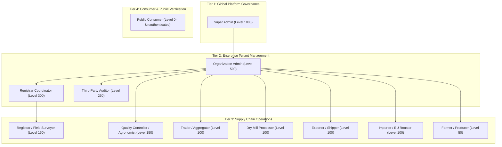
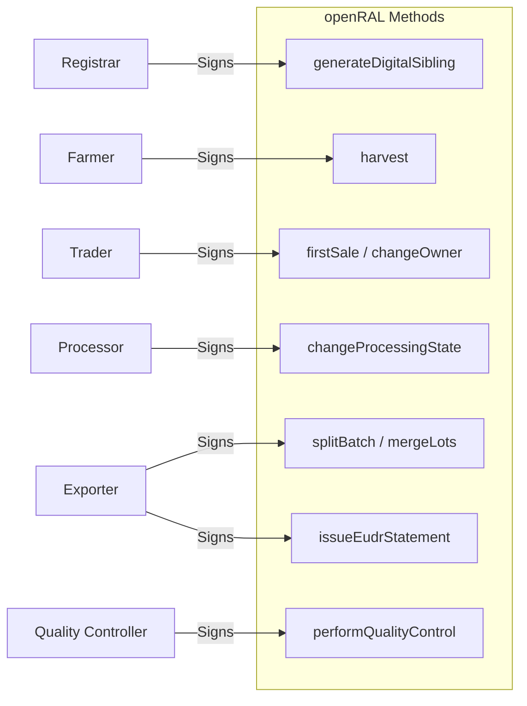
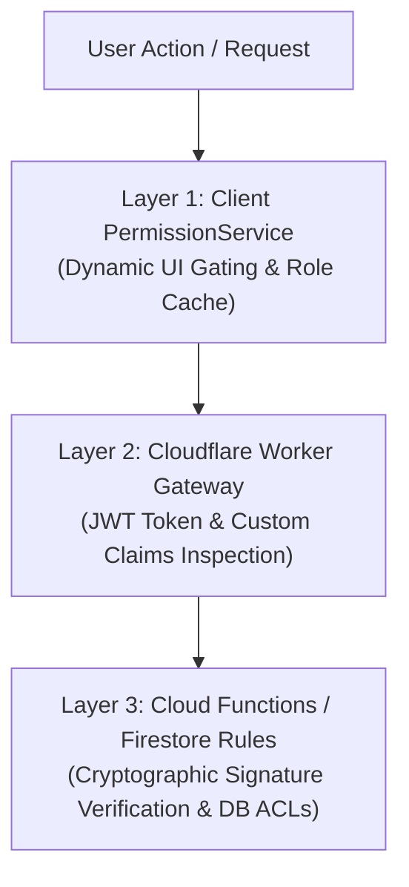

# 04_RBAC_MODEL.md
## TraceALot Role-Based Access Control (RBAC) & Governance Model

**Target Platform:** [https://tracealot.com](https://tracealot.com)  
**Security Standard:** NIST SP 800-162 (ABAC/RBAC Hybrid), Zero-Trust Identity Governance  
**Identity Provider:** Firebase Authentication + JWT Custom Claims + OpenID Connect (OIDC)  
**Cryptographic Binding:** Ed25519 Non-Repudiable Action Signing

---

## 1. Role Evolution & Taxonomy

The original implementation suffered from case inconsistency (`registrar` vs `Farmer`, `Trader`), unrepresented supply chain participants (Exporter, Quality Controller, Auditor, Public Consumer), and lacked organizational multi-tenancy. TraceALot establishes a standardized, 11-role enterprise RBAC taxonomy.

---

## 2. Detailed Role Definitions

| Role | Role Key | Hierarchy Level | Primary Persona & Responsibility |
| :--- | :--- | :--- | :--- |
| **Super Admin** | `SUPERADMIN` | `1000` | SaaS platform operator. Manages global tenants, system connectors, API gateways, and root schemas. |
| **Organization Admin** | `ORG_ADMIN` | `500` | Cooperative or enterprise executive. Manages tenant users, billing, quotas, regional units, and compliance policies. |
| **Registrar Coordinator** | `REG_COORD` | `300` | Regional field supervisor. Dispatches registrars, monitors collection quotas, and oversees survey data. |
| **Third-Party Auditor** | `AUDITOR` | `250` | Certification bodies (Rainforest Alliance, Fairtrade, EU Competent Authorities). Read-only audit access to immutable method histories and DDS statements. |
| **Quality Controller** | `QC_CONTROLLER` | `150` | Laboratory agronomist or surveyor reviewer. Validates field polygons, reviews deforestation scores, and approves/rejects registrations. |
| **Registrar** | `REGISTRAR` | `150` | Field agent with mobile device. Records producer KYC, surveys parcel boundaries via GPS, and operates offline. |
| **Dry Mill Processor** | `PROCESSOR` | `100` | Milling manager. Records wet-to-dry conversion, hulling, sorting, grading, and lot aggregation. |
| **Trader / Aggregator** | `TRADER` | `100` | Local buyer or cooperative buying station. Records initial farm purchases, manages container inventories, and executes peer sales. |
| **Exporter** | `EXPORTER` | `100` | International shipping manager. Consolidates green coffee lots, generates EUDR Due Diligence Statements, and books ocean shipments. |
| **Importer / Roaster** | `IMPORTER` | `100` | EU buyer or roastery operator. Inspects incoming customs DDS, verifies chain-of-custody, and manages roasting lots. |
| **Farmer / Producer** | `FARMER` | `50` | Smallholder producer. Views registered plots, records personal harvests, and authorizes transfers to buyers. |
| **Public Consumer** | `CONSUMER` | `0` | Retail customer scanning on-pack QR code. Views verifiable story, farm map, deforestation certificate, and lot timeline without login. |

---

## 3. Comprehensive RBAC Permissions Matrix

### Legend:
- `C` = Create / Execute
- `R` = Read / View
- `U` = Update / Modify
- `D` = Delete / Archive
- `-` = No Access

| Functional Domain / Capability | SUPERADMIN | ORG_ADMIN | REG_COORD | AUDITOR | QC_CONTROLLER | REGISTRAR | PROCESSOR | TRADER | EXPORTER | IMPORTER | FARMER | CONSUMER |
| :--- | :---: | :---: | :---: | :---: | :---: | :---: | :---: | :---: | :---: | :---: | :---: | :---: |
| **Tenant & User Management** | | | | | | | | | | | | |
| Manage Tenant Accounts | CRUD | - | - | - | - | - | - | - | - | - | - | - |
| Manage Tenant Users & Roles | CRUD | CRUD | R | R | - | - | - | - | - | - | - | - |
| View User Directory | R | R | R | R | R | R | R | R | R | R | - | - |
| **Producer & Farm Registration** | | | | | | | | | | | | |
| Register Farmer (Human) | CRUD | CRUD | CRUD | R | - | CR | - | - | - | - | - | - |
| Register Farm & Boundaries | CRUD | CRUD | CRUD | R | - | CR | - | - | - | - | - | - |
| Edit Polygon Geometries | CRUD | CRUD | RU | R | CRU | U | - | - | - | - | - | - |
| Approve / Reject Registrations | CRUD | CRUD | CRU | R | CRU | - | - | - | - | - | - | - |
| **Supply Chain & Processing** | | | | | | | | | | | | |
| Record Harvest Event | CRUD | CRUD | - | R | - | - | - | - | - | - | CR | - |
| Execute First Sale (Farmer->Trader) | CRUD | CRUD | - | R | - | - | - | CR | - | - | R | - |
| Manage Storage Containers / Bags | CRUD | CRUD | - | R | - | - | CRU | CRU | CRU | CRU | - | - |
| Dry Milling & Lot Transformation | CRUD | CRUD | - | R | - | - | CRU | - | - | - | - | - |
| Batch Splitting & Merging | CRUD | CRUD | - | R | - | - | CRU | CRU | CRU | CRU | - | - |
| Transfer Ownership (Peer-to-Peer) | CRUD | CRUD | - | R | - | - | CR | CR | CR | CR | - | - |
| **Compliance & EUDR** | | | | | | | | | | | | |
| Run WHISP Deforestation Risk | CRUD | CRUD | CR | R | CR | CR | R | R | CR | R | - | - |
| Query AgStack Asset Registry | CRUD | CRUD | CR | R | CR | CR | - | - | CR | - | - | - |
| Issue Due Diligence Statement (PDF/XML) | CRUD | CRUD | - | R | - | - | - | - | CR | R | - | - |
| Submit to EU TRACES NT Gateway | CRUD | CRUD | - | R | - | - | - | - | CR | - | - | - |
| Audit Method History & Signatures | R | R | R | R | R | R | R | R | R | R | - | - |
| **Public Transparency** | | | | | | | | | | | | |
| View Public Lot Origin & Timeline | R | R | R | R | R | R | R | R | R | R | R | R |
| Download Public Verified Certificate | R | R | R | R | R | R | R | R | R | R | R | R |

---

## 4. openRAL Method Execution Governance

Every action in openRAL creates an immutable method signed by the executing user. The following matrix governs which roles are permitted to construct and sign specific method types:

| openRAL Method (`RALType`) | Permitted Executing Roles | Required Input Objects | Produced Output Objects |
| :--- | :--- | :--- | :--- |
| **`generateDigitalSibling`** | `REGISTRAR`, `ORG_ADMIN`, `SUPERADMIN` | Physical Survey Data / KYC | `farm`, `field`, `human`, `container` |
| **`harvest`** | `FARMER`, `REGISTRAR` (Assisted), `ORG_ADMIN` | `field` | `coffee` (Harvest Batch) |
| **`changeOwner`** | `TRADER`, `PROCESSOR`, `EXPORTER`, `IMPORTER` | `coffee`, `bag`, `container` | Updated entity with new `currentOwners` |
| **`changeContainer`** | `TRADER`, `PROCESSOR`, `EXPORTER`, `IMPORTER` | `coffee`, source `container` | `coffee` in target `container` |
| **`changeProcessingState`** | `PROCESSOR`, `ORG_ADMIN` | `coffee` (e.g. cherry) | `coffee` (e.g. green bean) |
| **`splitBatch`** | `PROCESSOR`, `EXPORTER`, `IMPORTER` | 1 source `coffee` batch | $N$ child `coffee` fractional lots |
| **`mergeLots`** | `PROCESSOR`, `EXPORTER`, `TRADER` | $N$ source `coffee` batches | 1 composite `coffee` blend lot |
| **`performQualityControl`** | `QC_CONTROLLER`, `REG_COORD`, `SUPERADMIN` | `farm`, `field`, or `coffee` | Verified entity (`objectState: qcApproved`) |
| **`issueEudrStatement`** | `EXPORTER`, `ORG_ADMIN`, `SUPERADMIN` | Export Lot, Linked Fields | `eudrStatement`, Signed DDS PDF |

---

## 5. Security & Authorization Enforcement Architecture

Authorization is enforced through a three-layer defense-in-depth model:

### Layer 1: Client `PermissionService`
- Decodes Firebase ID Token Custom Claims (`userRole`, `tenantId`).
- Caches permissions in memory with instant invalidation upon logout or role assignment.
- Disables unauthorized speed-dial buttons, hidden menu items, and screen routes.

### Layer 2: Cloudflare Worker API Gateway
- Validates Firebase JWT signature using Google's public JWKS.
- Extracts `tenantId` and verifies that the targeted resource belongs to the user's organization (except for `SUPERADMIN` and public consumer routes).
- Throttles requests via rate-limiting tiers (e.g. 100 req/min for mobile clients, 10,000 req/day for auditors).

### Layer 3: Cloud Functions & Firestore Security Rules
- Evaluates `request.auth.token.role` directly within `firestore.rules`.
- For openRAL method pushes, `syncMethodToCloud` checks the Ed25519 digital signature against `TFC_keys/{userId}` to ensure the payload was signed by the authenticated identity.
