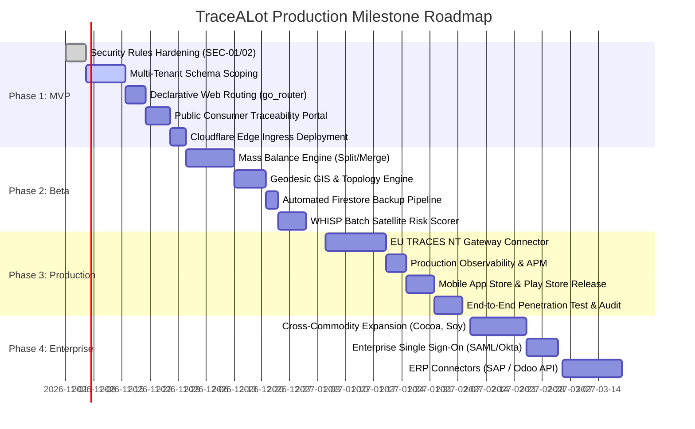

# 06_ROADMAP.md
## TraceALot Product Roadmap, Feature Specifications & Milestone Plan

**Target Platform:** [https://tracealot.com](https://tracealot.com)  
**Execution Framework:** Phased Agile Delivery (MVP -> Beta -> Production -> Enterprise)  
**Target Delivery Window:** Q4 2026 – Q2 2027  
**Architecture Lead:** Principal Flutter & Cloud Architect / Product Owner

---

## 1. Feature Prioritization Framework

Features are classified according to regulatory urgency, security risk, and enterprise SaaS functionality:

```mermaid
quadrantChart
    title Feature Prioritization Matrix
    x-axis Low Effort --> High Effort
    y-axis Low Impact --> High Impact
    quadrant-1 High Impact / High Effort (Strategic P1)
    quadrant-2 High Impact / Low Effort (Immediate P0)
    quadrant-3 Low Impact / Low Effort (Quick Wins P2)
    quadrant-4 Low Impact / High Effort (Defer P2)
    "Firestore Security Rules": [0.2, 0.95]
    "Declarative Web Routing": [0.3, 0.90]
    "Tenant Organization Isolation": [0.4, 0.92]
    "Public Consumer Trace Portal": [0.35, 0.88]
    "Lot Splitting & Mass Balance": [0.65, 0.85]
    "EU TRACES-NT Gateway": [0.8, 0.95]
    "Geodesic WGS84 GIS Engine": [0.6, 0.78]
    "Automated Cloud Backup Cron": [0.25, 0.70]
    "Multi-Commodity Support": [0.75, 0.65]
    "ERP Connectors (SAP/Odoo)": [0.85, 0.50]
```

- **P0: Critical (Immediate Blockers):** Security vulnerabilities, tenant isolation, web routing, basic public consumer access. Must be completed before any production traffic.
- **P1: Important (Core Business Value):** Lot mass balance, certified polygon validation, EUDR statement engine, automated backups, push notifications.
- **P2: Nice-to-Have (Enterprise Expansion):** Cross-commodity expansion, white-labeling, automated satellite monitoring crons, ERP connectors.

---

## 2. Detailed Technical Feature Specifications

### 2.1 Multi-Tenant Organization Scoping (P0)
- **Business Value:** Enables distinct cooperatives, commercial exporters, and international brands to operate on `tracealot.com` in strict data isolation without database collision.
- **Technical Design:** Introduce `tenantId` across all openRAL entities and methods. Inject `tenantId` into Firebase Auth Custom Claims. Update `PermissionService` and `firestore.rules` to filter all queries by tenant boundary.
- **Implementation Complexity:** High
- **Estimated Effort:** 10 Engineering Days
- **Dependencies:** None
- **Priority:** **P0**

---

### 2.2 Declarative Web Navigation & Deep Linking (`go_router`) (P0)
- **Business Value:** Enables bookmarkable URLs, browser back/forward buttons, direct navigation to specific farms (`/farms/:id`) and lots (`/lots/:id`), and fixes the broken web UX.
- **Technical Design:** Replace legacy `Navigator.push` in `main.dart` with `GoRouter`. Define structured route hierarchy with shell routes for desktop sidebars and guards for authentication and role privileges.
- **Implementation Complexity:** Medium
- **Estimated Effort:** 5 Engineering Days
- **Dependencies:** None
- **Priority:** **P0**

---

### 2.3 Public Consumer QR Traceability Portal (P0)
- **Business Value:** Closes the loop from "farm to cup". Allows retail consumers to scan product QR codes and view verifiable origin, roasting notes, farmer compensation, and deforestation proof.
- **Technical Design:** Build an unauthenticated, responsive lightweight route (`/p/:lotId`). Implemented with edge-cached SSR via Cloudflare Worker for instant sub-100ms loading and OpenGraph social meta tags.
- **Implementation Complexity:** Medium
- **Estimated Effort:** 6 Engineering Days
- **Dependencies:** Declarative routing
- **Priority:** **P0**

---

### 2.4 Mass Balance Lot Transformation Engine (Splitting & Blending) (P1)
- **Business Value:** Coffee supply chains routinely split bulk containers into retail bags, or merge micro-lots into composite export containers. Essential for dry mills and exporters.
- **Technical Design:** Implement `splitBatch` and `mergeLots` openRAL methods. Calculate weighted average cupping scores, moisture content, and proportional farm polygon lineage:
  $$\text{Polygon Proportion}_i = \frac{\text{Mass}_i}{\sum \text{Mass}_k}$$
  Record physical processing loss (e.g. cherry to parchment: $\approx 80\%$ weight loss).
- **Implementation Complexity:** High
- **Estimated Effort:** 12 Engineering Days
- **Dependencies:** openRAL Core Engine
- **Priority:** **P1**

---

### 2.5 Geodesic Polygon Topology & EUDR Validation Engine (P1)
- **Business Value:** Guarantees that farm boundaries meet strict EU Deforestation Regulation criteria without being rejected by official EU customs platforms.
- **Technical Design:** Replace planar Shoelace formula with Karney's geodesic algorithm on WGS84 ellipsoid. Add Bentley-Ottmann self-intersection validation (bow-ties / figure-8s), Douglas-Peucker point simplification, and neighbor overlap detection.
- **Implementation Complexity:** High
- **Estimated Effort:** 8 Engineering Days
- **Dependencies:** `field_geometry_service.dart`
- **Priority:** **P1**

---

### 2.6 EU TRACES-NT Direct B2G Gateway (P1)
- **Business Value:** Eliminates manual data re-entry into the European Commission's TRACES platform, saving exporters thousands of hours in administrative compliance.
- **Technical Design:** Cloud Function that converts validated DDS records and GeoJSON polygons into the official TRACES NT XML/JSON schema. Signs payloads with enterprise X.509 certificates and handles asynchronous submission polling.
- **Implementation Complexity:** Extreme
- **Estimated Effort:** 15 Engineering Days
- **Dependencies:** Mass balance engine, Geodesic GIS engine
- **Priority:** **P1**

---

### 2.7 Automated Cloud Backups & Point-in-Time Recovery (P1)
- **Business Value:** Disaster recovery compliance, protection against data corruption, and SOC2 / ISO 27001 audit readiness.
- **Technical Design:** Cloud Scheduler cron invoking Google Cloud Firestore managed export API daily. Backups streamed to an encrypted Cloud Storage bucket with 30-day lifecycle policies and cross-region replication.
- **Implementation Complexity:** Low
- **Estimated Effort:** 3 Engineering Days
- **Dependencies:** GCP IAM configuration
- **Priority:** **P1**

---

### 2.8 Push Notification & Audit Alert Pipeline (P2)
- **Business Value:** Alerts agronomists when new plots are submitted for QC, notifies traders when peer transfers arrive, and flags high deforestation risks instantly.
- **Technical Design:** Serverless Cloud Function triggered by Firestore `onWrite` events in `TFC_objects` and `TFC_methods`. Dispatches targeted Firebase Cloud Messaging (FCM) push notifications and transactional emails (via Brevo / Postmark).
- **Implementation Complexity:** Medium
- **Estimated Effort:** 6 Engineering Days
- **Dependencies:** Firebase Cloud Messaging
- **Priority:** **P2**

---

### 2.9 Multi-Commodity Expansion (Cocoa, Soy, Timber, Palm Oil) (P2)
- **Business Value:** Expands Addressable Market (TAM) beyond coffee to encompass all EUDR-regulated agricultural commodities.
- **Technical Design:** Abstract commodity-specific properties (e.g. wet/dry parchment for coffee vs fermentation state for cocoa) into schema plugins in `openRALTemplates`. Configure commodity-specific processing states and conversion ratios.
- **Implementation Complexity:** High
- **Estimated Effort:** 14 Engineering Days
- **Dependencies:** Mass balance engine
- **Priority:** **P2**

---

## 3. Phased Milestone Execution Plan



### Phase Details

#### Phase 1: MVP (Security & Core Web SaaS) — Target: 30 Days
- Deploy hardened `firestore.rules` and `storage.rules`.
- Establish `TFC_organizations` and multi-tenant scoping.
- Refactor navigation to `go_router` with responsive layouts.
- Launch `tracealot.com` landing page and `app.tracealot.com` on Cloudflare Pages.
- Launch consumer traceability portal at `tracealot.com/p/:lotId`.

#### Phase 2: Beta (Traceability Engine & GIS Hardening) — Target: 60 Days
- Implement mass balance lot splitting and merging with loss factors.
- Integrate WGS84 geodesic polygon validation and overlap detection.
- Automate daily Firestore snapshots to Cloud Storage.
- Pilot with 3 partner cooperatives and 500 smallholder coffee farmers.

#### Phase 3: Production (EUDR TRACES-NT & Global Launch) — Target: 90 Days
- Complete automated B2G submission to EU TRACES NT.
- Release native Android APK/AAB to Google Play and iOS to Apple App Store.
- Implement Datadog / Google Cloud Monitoring APM and alerting.
- Conduct third-party cybersecurity penetration test and GDPR audit.

#### Phase 4: Enterprise (Scale & Multi-Commodity) — Target: 180 Days
- Support Cocoa, Soy, and Palm Oil supply chain workflows.
- Implement Enterprise Single Sign-On (SAML 2.0 / Okta / Azure AD).
- Deploy automated webhook connectors for SAP, Microsoft Dynamics, and Odoo.
