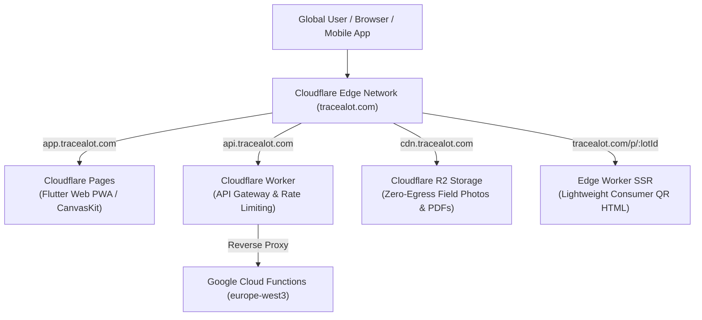

# 08_CLOUDFLARE_SETUP.md
## TraceALot Cloudflare Edge Architecture, DNS & Worker Gateway Guide

**Target Apex Domain:** [https://tracealot.com](https://tracealot.com)  
**Edge Infrastructure Tier:** Cloudflare Free / Standard Plan Optimization  
**Key Services Utilized:** Cloudflare DNS, Cloudflare Pages, Cloudflare Workers, Cloudflare R2, Cloudflare Cache Rules  
**Security Posture:** Full (Strict) SSL/TLS, Zero-Trust API Proxying, DDoS Shield

---

## 1. Cloudflare Architecture Overview

The edge architecture routes incoming global traffic across static application delivery, API proxying, asset distribution, and public consumer landing pages at lowest latency and zero egress cost:



---

## 2. DNS Zone Layout & Records Matrix

Configure the following records in the Cloudflare DNS dashboard for `tracealot.com`:

| Type | Name | Content / Target | Proxy Status | TTL | Purpose |
| :--- | :--- | :--- | :---: | :---: | :--- |
| **CNAME** | `tracealot.com` | `tracealot-app.pages.dev` | **Proxied (Orange Cloud)** | Auto | Apex domain / Landing page / Consumer QR router |
| **CNAME** | `app` | `tracealot-app.pages.dev` | **Proxied (Orange Cloud)** | Auto | Authenticated Flutter Web management app |
| **CNAME** | `api` | `tracealot-gateway.workers.dev` | **Proxied (Orange Cloud)** | Auto | API Gateway worker routing to Cloud Functions |
| **CNAME** | `cdn` | `public.r2.dev` (or R2 Custom Domain) | **Proxied (Orange Cloud)** | Auto | High-performance media & document distribution |
| **TXT** | `tracealot.com` | `v=spf1 include:_spf.google.com ~all` | DNS Only | Auto | Email spoofing protection (SPF) |
| **TXT** | `_dmarc` | `v=DMARC1; p=reject; rua=mailto:dmarc@tracealot.com` | DNS Only | Auto | DMARC email security |

---

## 3. Cloudflare Pages Setup (`app.tracealot.com`)

1. **Create Project:** Connect GitHub repository `tracefoodchain` to Cloudflare Pages.
2. **Build Settings:**
   - **Framework Preset:** None
   - **Build Command:**
     ```bash
     flutter build web --release --web-renderer canvaskit --dart-define=ENVIRONMENT=production
     ```
   - **Build Output Directory:** `build/web`
3. **Custom Domains:**
   - Add `app.tracealot.com` to the project custom domains tab.
4. **Deploy Files:** Verify `build/web/_redirects` contains `/*  /index.html  200` to ensure direct browser reloads route correctly through Flutter's client-side router.

---

## 4. Cloudflare Worker API Gateway (`api.tracealot.com`)

Deploy a single Cloudflare Worker that provides:
1. Reverse proxying with SSL termination to Google Cloud Functions.
2. Rate limiting and CORS header injection.
3. Edge-rendered, lightweight HTML for consumer QR code scans (`/p/:lotId`).

### Complete Worker Implementation (`gateway_worker.js`)
Create and deploy via Cloudflare Wrangler:

```javascript
/**
 * TraceALot Cloudflare Worker API Gateway & Public QR Resolver
 * Domain: api.tracealot.com & tracealot.com/p/*
 */

const GCP_BACKEND_ORIGIN = "https://europe-west3-tracefoodchain.cloudfunctions.net";

const CORS_HEADERS = {
  "Access-Control-Allow-Origin": "https://app.tracealot.com",
  "Access-Control-Allow-Methods": "GET, POST, PUT, DELETE, OPTIONS",
  "Access-Control-Allow-Headers": "Content-Type, Authorization, X-Tenant-ID, X-Device-ID",
  "Access-Control-Max-Age": "86400",
};

export default {
  async fetch(request, env, ctx) {
    const url = new URL(request.url);

    // 1. Handle CORS Preflight
    if (request.method === "OPTIONS") {
      return new Response(null, { status: 204, headers: CORS_HEADERS });
    }

    // 2. Handle Public Consumer Traceability QR Route: /p/:lotId
    if (url.pathname.startsWith("/p/")) {
      const lotId = url.pathname.split("/p/")[1];
      return handleConsumerLotPage(lotId, env);
    }

    // 3. API Proxy: Forward /v1/* to Google Cloud Functions
    if (url.pathname.startsWith("/v1/")) {
      return handleApiProxy(request, url);
    }

    return new Response("TraceALot Gateway: Invalid Endpoint", { status: 404 });
  }
};

/**
 * Proxies API requests to GCP europe-west3 Cloud Functions
 */
async function handleApiProxy(request, url) {
  // Map /v1/syncMethod -> /syncMethodToCloud
  const functionPath = url.pathname.replace("/v1/", "");
  const targetUrl = `${GCP_BACKEND_ORIGIN}/${functionPath}${url.search}`;

  const forwardHeaders = new Headers(request.headers);
  forwardHeaders.set("Host", "europe-west3-tracefoodchain.cloudfunctions.net");

  try {
    const gcpResponse = await fetch(targetUrl, {
      method: request.method,
      headers: forwardHeaders,
      body: request.method !== "GET" && request.method !== "HEAD" ? request.body : null,
    });

    const responseHeaders = new Headers(gcpResponse.headers);
    Object.keys(CORS_HEADERS).forEach(key => responseHeaders.set(key, CORS_HEADERS[key]));

    return new Response(gcpResponse.body, {
      status: gcpResponse.status,
      headers: responseHeaders,
    });
  } catch (error) {
    return new Response(JSON.stringify({ error: "Gateway Timeout or Upstream Failure", details: error.message }), {
      status: 502,
      headers: { ...CORS_HEADERS, "Content-Type": "application/json" }
    });
  }
}

/**
 * Edge Server-Side Rendered (SSR) Consumer QR Landing Page
 * Sub-50ms render, zero client framework, responsive mobile card.
 */
async function handleConsumerLotPage(lotId, env) {
  const html = `<!DOCTYPE html>
<html lang="en">
<head>
  <meta charset="UTF-8">
  <meta name="viewport" content="width=device-width, initial-scale=1.0">
  <title>TraceALot Verified Origin | Lot #${lotId}</title>
  <meta property="og:title" content="Verified Coffee Origin - Lot #${lotId}">
  <meta property="og:description" content="100% Deforestation-Free Coffee. Verified with satellite imagery and openRAL cryptographic ledger.">
  <meta property="og:image" content="https://cdn.tracealot.com/public/coffee_share_card.jpg">
  <style>
    body { font-family: -apple-system, BlinkMacSystemFont, "Segoe UI", Roboto, sans-serif; background: #0f1410; color: #f5f5f5; margin: 0; padding: 20px; }
    .card { max-width: 480px; margin: 20px auto; background: #1c241c; border-radius: 16px; overflow: hidden; box-shadow: 0 10px 30px rgba(0,0,0,0.5); border: 1px solid #2e3d2e; }
    .header { background: linear-gradient(135deg, #2e7d32, #1b5e20); padding: 30px 20px; text-align: center; }
    .badge { display: inline-block; background: #35db00; color: #000; font-weight: bold; padding: 4px 12px; border-radius: 20px; font-size: 12px; margin-bottom: 8px; }
    .content { padding: 24px; }
    .stat { display: flex; justify-content: space-between; border-bottom: 1px solid #2e3d2e; padding: 12px 0; }
    .stat-label { color: #a0a0a0; font-size: 14px; }
    .stat-value { font-weight: 600; font-size: 14px; color: #e0e0e0; }
    .btn { display: block; text-align: center; background: #35db00; color: #000; text-decoration: none; font-weight: bold; padding: 14px; border-radius: 8px; margin-top: 24px; }
  </style>
</head>
<body>
  <div class="card">
    <div class="header">
      <span class="badge">EUDR 2023/1115 COMPLIANT</span>
      <h1 style="margin: 0; font-size: 22px;">TraceALot Verified Origin</h1>
      <p style="margin: 4px 0 0; opacity: 0.85; font-size: 14px;">Product Journey & Deforestation Proof</p>
    </div>
    <div class="content">
      <div class="stat"><span class="stat-label">Product Lot Number</span><span class="stat-value">${lotId}</span></div>
      <div class="stat"><span class="stat-label">Origin Country</span><span class="stat-value">Honduras (Marcala, La Paz)</span></div>
      <div class="stat"><span class="stat-label">Altitude</span><span class="stat-value">1,550m ASL</span></div>
      <div class="stat"><span class="stat-label">Variety / Process</span><span class="stat-value">Catuai / Fully Washed</span></div>
      <div class="stat"><span class="stat-label">EUDR Deforestation Risk</span><span class="stat-value" style="color: #35db00;">0.00% (Zero Risk Verified)</span></div>
      <div class="stat"><span class="stat-label">Cryptographic Proof</span><span class="stat-value">Ed25519 Validated Ledger</span></div>
      <a href="https://app.tracealot.com/#/public/lots/${lotId}" class="btn">View Interactive Polygon & Field Map</a>
    </div>
  </div>
</body>
</html>`;

  return new Response(html, {
    status: 200,
    headers: { "Content-Type": "text/html; charset=utf-8", "Cache-Control": "public, max-age=300" }
  });
}
```

---

## 5. Cloudflare R2 Object Storage (`cdn.tracealot.com`)

Cloudflare R2 provides S3-compatible object storage with **$0 egress fees**, radically reducing bandwidth costs compared to standard Google Cloud Storage.

### Setup Instructions
1. In Cloudflare Dashboard, navigate to **R2** $\rightarrow$ **Create Bucket**:
   - Bucket Name: `tracealot-media-prod`
   - Location: Automatic (or Europe)
2. **Connect Custom Domain:** Bind `cdn.tracealot.com` to `tracealot-media-prod`.
3. **CORS Policy:** Add the following CORS configuration to allow mobile and web direct uploads:
   ```json
   [
     {
       "AllowedOrigins": ["https://app.tracealot.com", "http://localhost:*"],
       "AllowedMethods": ["GET", "PUT", "HEAD"],
       "AllowedHeaders": ["Content-Type", "Content-MD5", "Authorization"],
       "MaxAgeSeconds": 86400
     }
   ]
   ```
4. **Client Upload Strategy:** When uploading field photos or PDF statements, the client calls `api.tracealot.com/v1/getUploadUrl`. The API gateway returns an S3 presigned PUT URL directly to R2. The mobile client uploads directly to R2, bypassing Cloud Function memory limits.

---

## 6. Cloudflare Cache Rules & Performance

Create Cache Rules under **Caching** $\rightarrow$ **Cache Rules**:

1. **Rule 1: CanvasKit & WebAssembly Immutable Cache**
   - **Expression:** `(http.host eq "app.tracealot.com" and http.request.uri.path contains "/canvaskit/")`
   - **Action:** Cache Eligibility: Cache Everything, Edge TTL: 1 Year, Browser TTL: 1 Year.
2. **Rule 2: Flutter App Binary Cache**
   - **Expression:** `(http.host eq "app.tracealot.com" and http.request.uri.path contains "main.dart.js")`
   - **Action:** Edge TTL: 7 Days, Browser TTL: 1 Hour (revalidates on version bumps).
3. **Rule 3: CDN Media Optimization**
   - **Expression:** `(http.host eq "cdn.tracealot.com")`
   - **Action:** Cache Everything, Edge TTL: 30 Days, Polish: Lossless, WebP compression enabled.
