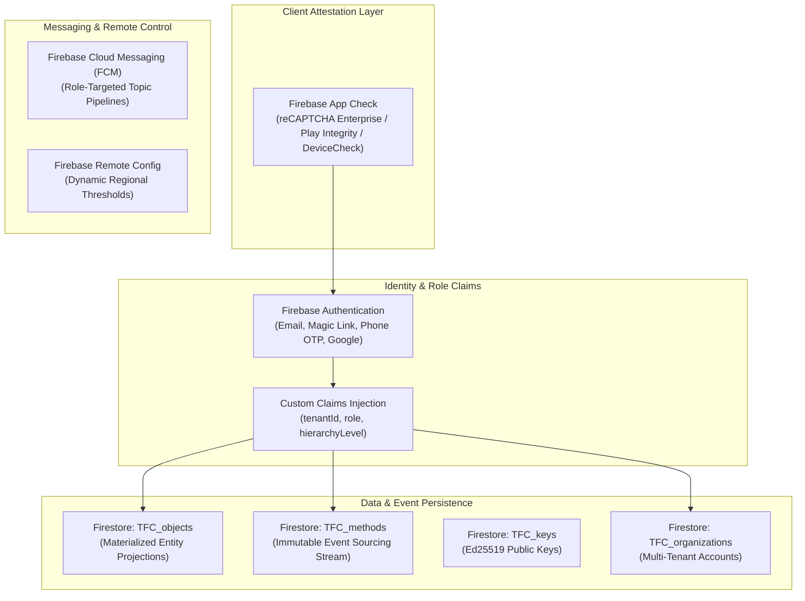
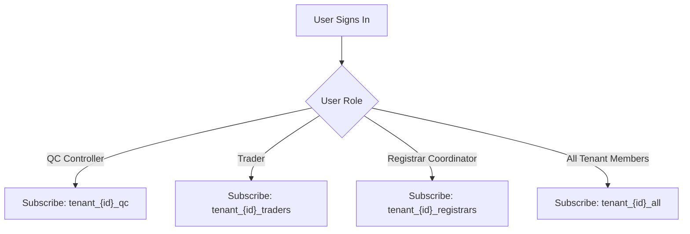

# 09_FIREBASE_SETUP.md
## TraceALot Firebase Enterprise Backend Configuration & Administration Guide

**Target Platform:** [https://tracealot.com](https://tracealot.com)  
**Firebase Project Region:** `europe-west3` (Frankfurt, Germany — EU Data Sovereignty)  
**Security & Governance Framework:** Zero-Trust IAM, App Check Attestation, Cryptographic Provenance  
**Target Architecture:** Multi-Tenant Enterprise Tier (Free-Tier & Pay-As-You-Grow Optimized)

---

## 1. Firebase Architecture Overview

Firebase provides identity, NoSQL event persistence, push notification triggers, and client attestation. The setup is configured for strict EU GDPR compliance, hosting all persistent cloud state in Google Cloud Frankfurt (`europe-west3`).



---

## 2. Firebase Authentication & Custom Claims

### 2.1 Provider Configuration
1. **Email / Password:** Enabled (with strict 8-character complexity, number, and special character requirements).
2. **Passwordless Email Link:** Enabled (for seamless web portal logins without remembering passwords).
3. **Phone Number (SMS OTP):** Enabled (critical for smallholder farmers in rural regions without email accounts).
4. **Google Identity (OAuth2):** Enabled (for enterprise agronomists, traders, and roasters).

### 2.2 Custom Claims Injection Pipeline
To enforce zero-trust security without performing expensive Firestore reads inside `firestore.rules`, user roles and tenant affiliations are injected directly into the user's JWT via a Cloud Function blocking trigger (`beforeUserSignedIn` / `onUserCreated`):

```javascript
// functions/src/auth/claimsTrigger.js
const functions = require("firebase-functions");
const admin = require("firebase-admin");

exports.beforeUserSignedIn = functions.region("europe-west3").auth.user().beforeSignIn(async (user, context) => {
  const db = admin.firestore();
  
  // 1. Fetch user openRAL profile from TFC_objects
  const userDoc = await db.collection("TFC_objects").doc(user.uid).get();
  
  let role = "TRADER"; // Default fallback
  let tenantId = "org_default";
  
  if (userDoc.exists) {
    const data = userDoc.data();
    const props = data.specificProperties || [];
    const roleProp = props.find(p => p.name === "userRole" || p.key === "userRole");
    if (roleProp && roleProp.value) {
      role = roleProp.value;
    }
    tenantId = data.tenantId || "org_default";
  }

  // 2. Return Custom Claims to be burned into the Firebase ID Token
  return {
    customClaims: {
      role: role,
      tenantId: tenantId,
      version: 1
    }
  };
});
```

---

## 3. Cloud Firestore Topology & Quota Hardening

### 3.1 Collections Topology
- `TFC_organizations/{tenantId}`: Tenant configuration, legal tax IDs, EORI number, default units.
- `TFC_objects/{objectId}`: Materialized state of entities (`farm`, `field`, `coffee`, `container`, `human`).
- `TFC_methods/{methodId}`: Append-only ledger of cryptographic supply chain transactions.
- `TFC_keys/{userId}`: Active and historical Ed25519 public keys.
- `TFC_eudr_statements/{statementId}`: Due diligence records submitted to customs or TRACES NT.

### 3.2 Firestore Cost & Quota Hardening Rules
1. **Batch Read Migration:** Eliminate the O(N) sequential loop in `view_history_screen.dart:57`. Replace with chunked `where(FieldPath.documentId(), whereIn: chunk)` queries (max 30 UIDs per query).
2. **CloudLog Throttling:** Client startup diagnostic logging in `CloudLogService` is throttled to record only on fatal errors or user switching, eliminating 50k+ daily write operations.
3. **Automated Document Expiration (TTL):** Transient synchronization staging documents in client caches and session tokens expire automatically after 7 days.

---

## 4. Firebase Storage Strategy

TraceALot implements a dual-tier storage strategy:
1. **Private / Restricted KYC Documents (Firebase Cloud Storage):** Producer national identity card scans and contracts are stored in Google Cloud Storage (`europe-west3`), guarded by `storage.rules`.
2. **Public High-Volume Media (Cloudflare R2):** Coffee cherries, plot boundary photographs, and public consumer sharing cards are stored in Cloudflare R2 (`cdn.tracealot.com`) to take advantage of zero egress fees.

---

## 5. Firebase App Check Attestation

Firebase App Check protects backend endpoints from unauthorized clients, bot attacks, and automated API scraping.

### Attestation Providers by Platform
- **Web (app.tracealot.com):** reCAPTCHA Enterprise / reCAPTCHA v3.
- **Android:** Google Play Integrity API.
- **iOS:** Apple DeviceCheck / App Attest.

### Client Initialization (`lib/main.dart`)
```dart
import 'package:firebase_app_check/firebase_app_check.dart';

Future<void> initializeAppCheck() async {
  await FirebaseAppCheck.instance.activate(
    webProvider: ReCaptchaV3Provider(
      const String.fromEnvironment('RECAPTCHA_SITE_KEY', defaultValue: '6Lxxxxxx'),
    ),
    androidProvider: AndroidProvider.playIntegrity,
    appleProvider: AppleProvider.appAttest,
  );
}
```

---

## 6. Firebase Remote Config Parameters

TraceALot uses Remote Config for dynamic runtime configuration without requiring mobile app store updates:

| Parameter Key | Data Type | Default Value | Description |
| :--- | :--- | :--- | :--- |
| `min_required_app_version` | String | `"1.7.4"` | Enforces mandatory app update banner on outdated mobile clients. |
| `whisp_risk_threshold` | String | `"medium"` | Maximum permissible deforestation probability before flagging a field in QC. |
| `max_polygon_vertices` | Integer | `500` | Maximum vertices before automatic Douglas-Peucker polygon simplification triggers. |
| `cloud_sync_frequency_sec` | Integer | `600` | Background periodic sync interval in seconds. |
| `enable_mass_balance_split` | Boolean | `true` | Feature flag to enable/disable lot splitting in trader speed-dial menu. |
| `active_eudr_regulation_date`| String | `"2020-12-31"`| Cut-off date for deforestation-free verification under EUDR Article 2. |

---

## 7. Firebase Cloud Messaging (FCM) Topic Hierarchy

Push notifications are targeted using tenant-scoped FCM topics:



### Event Notification Triggers
- **New Field Pending QC:** Dispatches push notification to `tenant_{tenantId}_qc`.
- **Peer Transfer Received:** Dispatches direct FCM data message to target trader device ID.
- **EUDR Non-Compliance Alert:** High deforestation risk detected by WHISP alerts tenant administrators instantly.

---

## 8. Disaster Recovery & Automated Firestore Backup Pipeline

To guarantee enterprise business continuity and compliance with ISO 27001 data retention standards, an automated daily backup pipeline is established.

### Cloud Scheduler & Cloud Function Setup
1. **Create Backup Storage Bucket:** Create a multi-region Google Cloud Storage bucket `gs://tracefoodchain-backups-prod`.
2. **Cloud Function Backup Script:**
```javascript
// functions/src/ops/backupFirestore.js
const admin = require("firebase-admin");
const firestore = require("@google-cloud/firestore");

exports.scheduledFirestoreBackup = async (context) => {
  const client = new firestore.v1.FirestoreAdminClient();
  const projectId = process.env.GCP_PROJECT || "tracefoodchain";
  const databaseName = client.databasePath(projectId, "(default)");
  const bucket = "gs://tracefoodchain-backups-prod";

  const timestamp = new Date().toISOString().replace(/[:.]/g, "-");
  const outputUriPrefix = `${bucket}/daily-backups/${timestamp}`;

  try {
    const [response] = await client.exportDocuments({
      name: databaseName,
      outputUriPrefix: outputUriPrefix,
      collectionIds: ["TFC_objects", "TFC_methods", "TFC_organizations", "TFC_keys", "TFC_eudr_statements"]
    });
    console.log(`Firestore export started: ${response.name}`);
  } catch (err) {
    console.error("Firestore automated export failed:", err);
    throw err;
  }
};
```
3. **Cloud Scheduler Schedule:** Trigger daily at `02:00 UTC`:
   ```bash
   gcloud scheduler jobs create pubsub firestore-daily-backup \
     --schedule="0 2 * * *" \
     --topic="firestore-backup-trigger" \
     --location="europe-west3"
   ```
4. **Lifecycle Policy:** Backups are retained for 30 days in GCS Nearline, then transitioned to Coldline for 5 years to fulfill EUDR record-keeping mandates.
