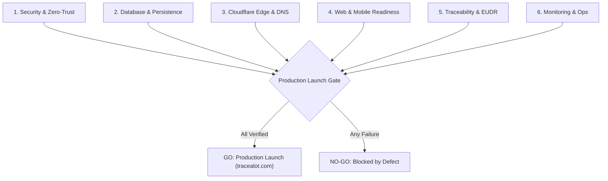

# 10_PRODUCTION_CHECKLIST.md
## TraceALot Production Launch Pre-Flight Verification & Sign-Off Matrix

**Target Production Domain:** [https://tracealot.com](https://tracealot.com)  
**Launch Authorization:** Quality Assurance, Security Officer, Lead Architect & Product Owner  
**Review Version:** `1.7.4+36` to Production Target  
**Sign-Off Criterion:** 100% Mandatory Gating Checks Pass Prior to Production DNS Cutover

---

## 1. Executive Pre-Flight Dashboard

---

## 2. Pillar 1: Security & Identity Governance

| Item | Verification Task | Verification Command / Metric | Status | Sign-off |
| :---: | :--- | :--- | :---: | :---: |
| **SEC-1.1** | Deploy production `firestore.rules`. Ensure zero open public reads or unauthenticated writes. | `firebase deploy --only firestore:rules` | [ ] | Security Officer |
| **SEC-1.2** | Deploy production `storage.rules`. Validate MIME types (`image/*`, `application/pdf`) and max sizes (15MB / 25MB). | `firebase deploy --only storage` | [ ] | Security Officer |
| **SEC-1.3** | Remove emergency role script (`emergency_role_assignment.dart`) and test debug files from git. | Git inspection: confirm file removed | [ ] | Lead Architect |
| **SEC-1.4** | Strip all raw API keys from `.env` client bundles. Route third-party calls through `api.tracealot.com`. | Inspect compiled `main.dart.js` for string leaks | [ ] | Lead Architect |
| **SEC-1.5** | Decouple Login and Registration in `sign_up_screen.dart`. Disable auto-create on `invalid-credential`. | Manual QA test with invalid password | [ ] | QA Lead |
| **SEC-1.6** | Verify Ed25519 signing key rollover and ensure keys are isolated in `FlutterSecureStorage` per user. | Multi-user login test on same device | [ ] | Lead Architect |
| **SEC-1.7** | Activate Firebase App Check across Web (reCAPTCHA Enterprise) and Android (Play Integrity). | Firebase Console: App Check metrics live | [ ] | DevOps Lead |

---

## 3. Pillar 2: Database, Storage & Sync Integrity

| Item | Verification Task | Verification Command / Metric | Status | Sign-off |
| :---: | :--- | :--- | :---: | :---: |
| **DAT-2.1** | Deploy composite indexes from `firestore.indexes.json` to prevent query fallback degradation. | `firebase deploy --only firestore:indexes` | [ ] | Database Admin |
| **DAT-2.2** | Replace O(N) sequential `.get()` loop in `view_history_screen.dart` with chunked `whereIn` queries. | Network profiler: $< 5$ requests for 500 items | [ ] | Flutter Architect |
| **DAT-2.3** | Verify Cloud Scheduler automated daily Firestore export cron to `gs://tracefoodchain-backups-prod`. | Cloud Console: verify backup run completed | [ ] | DevOps Lead |
| **DAT-2.4** | Test offline-to-online sync recovery: submit 20 transactions offline, reconnect, verify cloud ACK. | Field simulation: flight mode test | [ ] | QA Lead |
| **DAT-2.5** | Verify media outbox durable upload state machine (`capturedLocal` $\rightarrow$ `confirmedRemote`). | Storage verification: inspect bucket contents | [ ] | QA Lead |
| **DAT-2.6** | Throttle `CloudLogService` so ordinary client app starts do not bleed Firestore write quotas. | Firestore usage: confirm $< 2$ writes per start | [ ] | DevOps Lead |

---

## 4. Pillar 3: Cloudflare Edge & Domain Infrastructure

| Item | Verification Task | Verification Command / Metric | Status | Sign-off |
| :---: | :--- | :--- | :---: | :---: |
| **EDG-3.1** | Apex domain `tracealot.com` resolves with Full (Strict) SSL/TLS certificate. | `curl -Iv https://tracealot.com` | [ ] | DevOps Lead |
| **EDG-3.2** | `app.tracealot.com` connects to Cloudflare Pages and serves the Flutter Web CanvasKit bundle. | HTTP 200 OK, asset cache headers active | [ ] | DevOps Lead |
| **EDG-3.3** | `api.tracealot.com` Cloudflare Worker proxies requests to GCP europe-west3 with CORS headers. | `curl -X OPTIONS https://api.tracealot.com/v1/sync` | [ ] | DevOps Lead |
| **EDG-3.4** | `cdn.tracealot.com` Cloudflare R2 bucket serves media assets with zero egress cost. | Test image load from R2 domain | [ ] | DevOps Lead |
| **EDG-3.5** | Public consumer URL `tracealot.com/p/:lotId` returns instant server-side rendered HTML card ($< 100\text{ms}$). | `curl -Iv https://tracealot.com/p/TEST-LOT-01` | [ ] | QA Lead |
| **EDG-3.6** | Validate SPA fallback: reload `app.tracealot.com/farms` directly without encountering 404 errors. | Browser direct URL reload test | [ ] | QA Lead |

---

## 5. Pillar 4: Web & Mobile Application Readiness

| Item | Verification Task | Verification Command / Metric | Status | Sign-off |
| :---: | :--- | :--- | :---: | :---: |
| **CLI-4.1** | Refactor routing to `go_router`. Verify browser back/forward buttons and URL bar synchronization. | Web navigation stress test | [ ] | Flutter Architect |
| **CLI-4.2** | Eliminate `syncFromCloud: !isWebLandscape` barrier so desktop web users receive real-time updates. | Web sync verification in landscape browser | [ ] | Flutter Architect |
| **CLI-4.3** | Validate explicit text colors across all themes (no white-on-white text in dialogs or headers). | Full UI audit across Light/Dark modes | [ ] | UX Designer |
| **CLI-4.4** | Run `flutter gen-l10n` and verify that all 4 locales (EN, ES, DE, FR) have 0 missing localization keys. | `flutter gen-l10n --dry-run` | [ ] | Localization Lead |
| **CLI-4.5** | Android: Verify signed Release App Bundle (AAB) builds with ProGuard/R8 obfuscation enabled. | `flutter build appbundle --release` | [ ] | Mobile Lead |
| **CLI-4.6** | iOS: Verify Release IPA archive builds cleanly against iOS 17/18 SDK with active provisioning profile. | `flutter build ipa --release` | [ ] | Mobile Lead |

---

## 6. Pillar 5: Traceability, GIS & EUDR Compliance

| Item | Verification Task | Verification Command / Metric | Status | Sign-off |
| :---: | :--- | :--- | :---: | :---: |
| **EUDR-5.1**| Verify WGS84 geodesic polygon area calculation matches Karney's formula within $\pm 0.1\%$ error. | GIS test fixture against known farm polygons | [ ] | GIS Specialist |
| **EUDR-5.2**| Verify self-intersection detection flags bow-tie polygons before submission. | Invalid polygon test fixture rejection | [ ] | GIS Specialist |
| **EUDR-5.3**| Validate WHISP satellite deforestation scoring returns valid zero/negligible risk for compliant plots. | Mock & Live WHISP proxy verification | [ ] | Agronomist / QC |
| **EUDR-5.4**| Verify Due Diligence Statement (DDS) PDF generation correctly converts net mass to Green Bean Equivalent. | PDF inspection: EORI, HS Code, Plot Table | [ ] | Compliance Officer |
| **EUDR-5.5**| Validate triple-redundant container linkage (Field $\leftrightarrow$ Farm) on all newly registered parcels. | Data integrity check in Firestore | [ ] | Lead Architect |

---

## 7. Pillar 6: Monitoring, Observability & Incident Response

| Item | Verification Task | Verification Command / Metric | Status | Sign-off |
| :---: | :--- | :--- | :---: | :---: |
| **OPS-6.1** | Configure Cloudflare Web Analytics and Google Cloud Monitoring dashboards. | Live traffic telemetry visible | [ ] | DevOps Lead |
| **OPS-6.2** | Establish Slack / Discord webhook alerts for Cloud Functions 5xx errors and sync failure spikes. | Trigger test exception; verify alert receipt | [ ] | DevOps Lead |
| **OPS-6.3** | Uptime monitoring: Configure synthetic ping probes on `app.tracealot.com` and `api.tracealot.com`. | Uptime monitoring service status: UP | [ ] | DevOps Lead |
| **OPS-6.4** | Document Disaster Recovery & Emergency Key Rollover runbook for production on-call engineers. | Runbook published in engineering wiki | [ ] | Lead Architect |

---

## 8. Final Go / No-Go Sign-Off Form

| Authority Role | Name | Decision (GO / NO-GO) | Signature & Date |
| :--- | :--- | :---: | :--- |
| **Lead Flutter Architect** | _______________________ | [ ] GO  [ ] NO-GO | _____________________ |
| **Principal Security Officer** | _______________________ | [ ] GO  [ ] NO-GO | _____________________ |
| **Lead DevOps Engineer** | _______________________ | [ ] GO  [ ] NO-GO | _____________________ |
| **Product Owner / Business**| _______________________ | [ ] GO  [ ] NO-GO | _____________________ |

> [!IMPORTANT]
> A single **NO-GO** vote in any pillar blocks the production cutover of `tracealot.com`. All items marked `[ ]` above must be checked and signed off prior to changing the primary DNS A/CNAME records.
